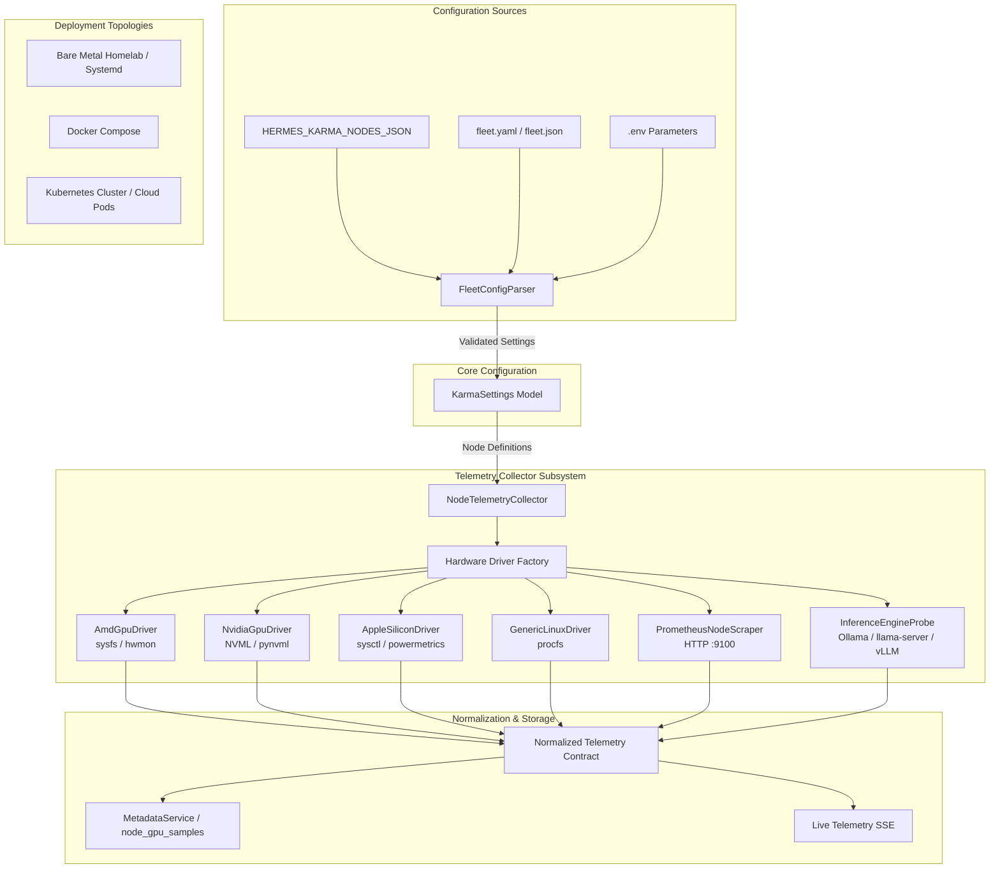
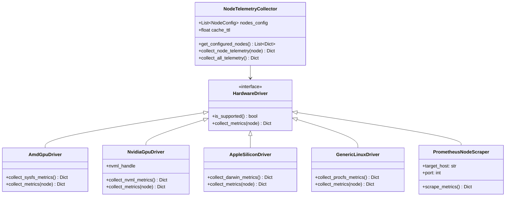

# Architectural Blueprint: Declarative Fleet Configuration & Portable Deployment (SPEC-HK-008)

## 1. System Topology & Architecture

This blueprint specifies the decoupling of `HermesKarma`'s telemetry collection and deployment layer from specific homelab hardware, establishing a declarative, vendor-agnostic architecture.



---

## 2. Configuration Parser & Precedence Hierarchy

Configuration resolution follows a deterministic precedence waterfall:

1. **Inline Environment JSON (`HERMES_KARMA_NODES_JSON`):** Takes absolute precedence; designed for zero-filesystem cloud environments (Kubernetes ConfigMaps, AWS ECS, Google Cloud Run).
2. **Declarative Configuration File (`FLEET_CONFIG_PATH`):** Points to a `fleet.yaml` or `fleet.json` file on disk. Defaults to `~/.hermes_karma/fleet.yaml` if it exists.
3. **Legacy Environment Variables:** Parses `COORDINATOR_*`, `REMOTE_WORKER_*`, `CHUNKITO_*`, and `BEEHIVE_*` variables from `.env` for full backward compatibility.
4. **Localhost Loopback Default:** If zero nodes are configured, automatically initializes a single local coordinator node reading local system telemetry.

---

## 3. Class Hierarchy & Hardware Driver Strategy Pattern



---

## 4. Container Deployment & Volume Boundaries

```mermaid
flowchart LR
    subgraph Host ["Host System / Homelab / K8s Node"]
        H_State["~/.hermes/state.db (SQLite WAL)"]
        H_Skills["~/.hermes/skills/"]
        H_Karma["~/.hermes_karma/metadata.db"]
        H_Sysfs["/sys (Hardware Sensors)"]
    end

    subgraph Container ["HermesKarma Container (Rootless UID 1000)"]
        C_App["FastAPI Backend (:8020)"]
        C_Static["Vanilla JS Dashboard"]
    end

    H_State -->|Mount :ro (Read-Only)| C_App
    H_Skills -->|Mount :ro (Read-Only)| C_App
    H_Karma -->|Mount :rw (Read-Write)| C_App
    H_Sysfs -->|Mount :ro (Optional)| C_App
```

### Safety Rules:
- **Hermes State Isolation:** The container must **never** mount `~/.hermes` in read-write mode. Read-only (`:ro`) mounting preserves WAL integrity and prevents database lock contentions with active agent CLI sessions.
- **Rootless Execution:** Container runs strictly as non-root user `karma` (UID/GID 1000).
- **Graceful Hardware Degradation:** If `/sys` is not mounted into the container, the driver factory seamlessly falls back to `GenericLinuxDriver` or Prometheus network scraping without crashing.
