# Architectural Blueprint: Homelab 3D Spatial Visualizer (SPEC-HK-009)

## 1. System Topology & Three.js Scene Graph

This blueprint defines the runtime component hierarchy, Three.js WebGL scene graph, and real-time streaming pipeline for the Homelab 3D Spatial Visualizer in `HermesKarma`.

```mermaid
graph TD
    subgraph ThreeScene ["Three.js Scene Graph (visualizer_scene.js)"]
        SceneRoot[THREE.Scene Root]
        
        subgraph EnvironmentalRig ["Environment & Lighting"]
            AmbientLight[THREE.AmbientLight: #1e293b, 0.6]
            DirLight1[Key DirectionalLight: #38bdf8, 1.2]
            DirLight2[Rim DirectionalLight: #a855f7, 0.8]
            DatumGrid[Datum Hex Grid Mesh: Y = 0.0]
            TailscaleLattice[WireGuard Mesh Lattice Lines]
        end
        
        subgraph NodeChassisGroup ["Procedural Machine Assemblies (ChassisMeshFactory)"]
            subgraph ArchetypeGenerators ["Universal Open-Source Archetypes"]
                GenMiniPc["buildMiniPcMesh()<br/>Squircle + Top Vent + APU"]
                GenTower["buildTowerMesh()<br/>Workstation / PCIe GPU / SFF"]
                GenPhone["buildPhoneMesh()<br/>Mobile Slab + OLED Surface"]
                GenLaptop["buildLaptopMesh()<br/>Clamshell + Angled Display"]
                GenTablet["buildTabletMesh()<br/>Thin Tablet / E-Ink Slate"]
                GenRack["buildServerRackMesh()<br/>1U/2U Rackmount + Drives"]
            end
            
            subgraph PresetVariants ["Specialized Homelab Presets"]
                BeehiveChassis[Beehive: Beelink SER8]
                ChunkitoChassis[Chunkito: MS-S1 Max]
                ChubbsChassis[Chubbs: Win Max 2]
                RemarkableChassis[reMarkable 2 E-Ink]
                CarmelChassis[Carmel Edge Beelink EQi]
                PixelChassis[Pixel 9 Pro Visor]
            end
            
            ArchetypeGenerators --> PresetVariants
        end

        subgraph InteriorSilicon ["Living Silicon Sub-Meshes"]
            APUDie[APU / CPU Silicon Die Mesh]
            VRAMPool[3D Volumetric VRAM Pool Bar]
            SlotArray[12-Slot Inference Cube Grid]
            NVMeIndicators[NVMe Flash Activity LEDs]
        end

        subgraph DynamicConduits ["Conduit & Particle System"]
            InferenceConduit[Inference Highway: Bezier Tube]
            SyncConduit[Syncthing Vault Sync: Bezier Tube]
            OcrConduit[reMarkable Ingest: Bezier Tube]
            SurveillanceConduit[Carmel Cypher Stream: Bezier Tube]
            FlowParticles[InstancedMesh Flow Photon Particles]
        end

        SceneRoot --> EnvironmentalRig
        SceneRoot --> NodeChassisGroup
        NodeChassisGroup --> InteriorSilicon
        SceneRoot --> DynamicConduits
        DynamicConduits --> FlowParticles
    end

    subgraph StreamingPipeline ["Real-Time Telemetry Pipeline"]
        Collector[NodeTelemetryCollector] --> VisService[VisualizerService]
        LlamaMetrics[llama-server /metrics & /slots] --> VisService
        Neo4jState[Neo4j Cypher Metrics] --> VisService
        VisService --> SSEHub[FastAPI SSE Stream /api/visualizer/stream]
        SSEHub --> SceneManager[HomelabVisualizerScene Client]
        SceneManager -->|Update Emissive Dies & Slots| InteriorSilicon
        SceneManager -->|Modulate Flow Speed & Color| FlowParticles
    end
```



---

## 2. 3D Spatial Coordinate Layout & Dual-Mode Lerping

The visualizer supports two distinct spatial representations, interpolated smoothly on the client via spherical lerp ($\vec{P}(t) = (1-\alpha)\vec{P}_{\text{spatial}} + \alpha\vec{P}_{\text{topology}}$):

### 2.1 Spatial Physical Mode (Default)
Arranges machines according to their real-world spatial, functional, and physical clustering:
- **Central Capitola Desk Datum ($X \approx 0, Z \approx 0$):**
  - `beehive` (SER8): Central Coordinator origin at $[0.0, 0.45, 0.0]$.
  - `chunkito` (MS-S1 Max): Heavy compute stack placed to the right at $[7.0, 0.8, -2.0]$ with an isometric $-12^\circ$ yaw.
- **Mobile & Knowledge Capture Cluster ($X < 0$):**
  - `chubbs` (GPD Win Max 2): Handheld workstation at $[-6.0, 0.2, 3.0]$.
  - `remarkable` (reMarkable 2): Digital paper notepad resting flat at $[-5.5, 0.05, -4.5]$.
  - `pixel-9-pro` (Pixel 9 Pro): Smartphone lying flat at $[-2.0, 0.05, 5.0]$.
- **Carmel Valley Edge Cluster ($X > 0, Z > 0$):**
  - `carmel-edge` (Beelink EQi): Remote surveillance gateway stationed at $[6.5, 0.4, 5.5]$.

### 2.2 Network Topology Mode
Arranges machines into a force-directed concentric star graph:
- **Hub:** `beehive` anchored at origin $[0, 0, 0]$.
- **Inference Satellite:** `chunkito` elevated on primary compute riser at $[0, 2.5, -6.0]$.
- **Edge Satellites:** `carmel-edge`, `chubbs`, `remarkable`, `pixel-9-pro` positioned radially around the hub with radial distance proportional to WireGuard ping RTT latency ($r \propto \log(1 + \tau_{\text{RTT}})$).

---

## 3. Shader Materials & Cyber-Chassis Styling

The visualizer uses high-performance Three.js physical materials to create translucent, frosted hardware shells revealing the warm interior computing components:

```javascript
// Translucent Cyber-Chassis Material Factory
function createCyberChassisMaterial(accentColor = 0x38bdf8) {
  return new THREE.MeshPhysicalMaterial({
    color: 0x0f172a,
    metalness: 0.2,
    roughness: 0.15,
    transmission: 0.65,      // Glass-like light transmission
    thickness: 0.8,          // Simulates optical glass depth
    ior: 1.45,               // Refraction index of polycarbonate
    transparent: true,
    opacity: 0.82,
    reflectivity: 0.5,
    clearcoat: 0.3,
    clearcoatRoughness: 0.1,
  });
}

// Glowing Silicon Die Material Factory
function createSiliconDieMaterial(baseColor = 0x00ffcc) {
  return new THREE.MeshStandardMaterial({
    color: baseColor,
    emissive: baseColor,
    emissiveIntensity: 0.3,  // Modulated by load (0.3 -> 1.5)
    roughness: 0.1,
    metalness: 0.9,
  });
}
```

---

## 4. Conduit Flow Particles & Particle Instancing

To guarantee $\ge 60$ FPS across both desktop and mobile devices without memory leaks:
1. **Instanced Rendering:** Particles are rendered using a single `THREE.InstancedMesh` with 256 instances rather than hundreds of individual mesh objects.
2. **Parametric Tangent Progression:** Each particle updates its position $s \in [0, 1]$ along its assigned Bezier curve:
   $$s_{t+\Delta t} = (s_t + v_{\text{particle}} \cdot \Delta t) \pmod{1.0}$$
3. **Dynamic Matrix Transforms:** Particle position $\vec{x}(s)$ and tangent orientation $\vec{T}(s) = \frac{\mathrm{d}\vec{B}(s)}{\mathrm{d}s}$ update instance transform matrices in a single bounded buffer write per frame.
4. **Color Modulation:** Token stream particles dynamically lerp colors based on instantaneous throughput:
   - $<30 \text{ tok/s}$: Cool Electric Cyan (`#00ffcc`)
   - $30–80 \text{ tok/s}$: Vibrant Emerald (`#10b981`)
   - $>80 \text{ tok/s}$ or Prefill Burst: Amber-to-Crimson Redline (`#f59e0b` $\to$ `#ef4444`)

---

## 5. Security & Network Privacy Invariants

1. **Zero Raw Private IP Exposure:** The visualizer API and client-side models MUST NOT expose raw private Tailscale IPs (`100.x.y.z`) or LAN IPs in DOM elements, tooltips, or network payloads. All nodes are identified by logical ID (`beehive`, `chunkito`, etc.) and role.
2. **Zero Insecure Cloudflare Bridges:** All WebSocket or SSE streams originate from the local origin or Cloudflare Zero Trust authenticated session cookie.
3. **Read-Only Telemetry:** The visualizer endpoint is strictly read-only; no mutative controls, reboot commands, or daemon mutations can be dispatched from the 3D viewport.
