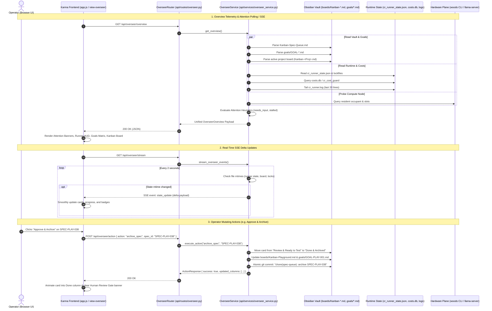

# Architectural Blueprint: Christopher Robin Overseer & Dynamic Spec Queue Control Plane (SPEC-HK-010)

## 1. System Topology & Architectural Overview

This document details the architectural contracts, data flow pipelines, state reconciliation algorithms, and component hierarchy for the **Christopher Robin Overseer & Dynamic Spec Queue Control Plane** in `HermesKarma`.



---

## 2. Ingestion & State Reconciliation Engine

### 2.1 File Ingestion Paths & Formats
The `OverseerService` coordinates between three persistent layers without requiring a database migration:

| Source Entity | Filesystem Location | Read Strategy | Ingestion Frequency |
|---|---|---|---|
| **Central Spec Queue** | `/home/jagosan/obsidian/vault/boards/Kanban-Spec-Queue.md` | Non-blocking regex / line parser | On-request / SSE mtime watch |
| **Macro-Goals** | `/home/jagosan/obsidian/vault/goals/GOAL-*.md` | Non-blocking UTF-8 frontmatter + body parser | Cached (15s TTL) |
| **Project Boards** | `/home/jagosan/obsidian/vault/boards/Kanban-<Proj>.md` | Targeted subtask scanner for active spec | On-request for active spec |
| **Runner State** | `~/.hermes/cr_runner_state.json` | JSON read with file existence check | On-request / SSE mtime watch |
| **Lockfiles** | `~/.hermes/runner_paused`, `~/.hermes/governor_paused` | `os.path.exists()` check | 1Hz check |
| **Runner Logs** | `~/.hermes/logs/cr_runner.log`, `cr_governor.log` | Seek to EOF - 64KB, scan last N lines | On-request / drawer open |
| **Cloud Ledger** | `~/.hermes/costs.db` | Read-only SQLite query (`date = date('now')`) | Cached (30s TTL) |
| **Hardware Node** | `http://100.71.183.123:11434/slots` & `woods status` | NodeTelemetryCollector cache | Cached (15s TTL) |

### 2.2 Board Parser Robustness & Parsing Rules
To ensure zero parser crashes across evolving markdown formats:
* **Encoding Guard:** File reading uses `encoding="utf-8", errors="replace"` to prevent UnicodeDecodeError on malformed editor buffers.
* **Column Extraction:** Regex matches headers with or without emoji prefixes (`## (?:📥|⏳|🚨|🚧|⏸️|🧪|✅)?\s*(Backlog|Queued|Expedited|Running|Paused|Review\s*&\s*Ready\s*to\s*Test|Done\s*&\s*Archived)`).
* **Card Attribute Parsing:**
  * Spec ID: `\*\*\[(SPEC-[A-Za-z0-9_-]+)\]\*\*`
  * Workspace: `Workspace:\s*[`"]?([^`"|\n]+)[`"]?`
  * Board link: `Board:\s*\[\[([^\]]+)\]\]`
  * Spec link: `Spec:\s*[`"]?([^`"|\n]+)[`"]?` or `\[\[(specs/[^\]]+)\]\]`
  * Engine tag: `#engine/(tigger|jagular|heffalump|gemini)`
  * Priority: `#p0`, `#p1`, `#p2`
  * Completed phases tag: `#phase/(\d+)-done` or child checkbox counts `- [x]` vs `- [ ]`

---

## 3. Attention & Stall Heuristic Matrix

The attention engine evaluates system health deterministically every tick:

```
┌────────────────────────────────────────────────────────────────────────┐
│                        OVERSEER ATTENTION MATRIX                       │
├──────────────────────────────────┬─────────────────────────────────────┤
│  CATEGORY: NEEDS YOUR INPUT 🟡   │  CATEGORY: STALLED OR BLOCKED 🔴    │
├──────────────────────────────────┼─────────────────────────────────────┤
│ 1. HUMAN_PLAYTEST_REQUIRED       │ 1. RUNNER_PAUSED                    │
│    All phases completed in       │    ~/.hermes/runner_paused exists   │
│    'Review & Ready to Test'.     │                                     │
│ 2. HUMAN_REVIEW_GATE             │ 2. STALL_LOOP_DETECTED              │
│    ≥ 3 specs accumulate in       │    stall_count ≥ 2 (warn) or        │
│    Review & Ready to Test.       │    stall_count ≥ 10 (critical)      │
│ 3. READY_FOR_SPEC_AUTHORING      │ 3. PHASE_FAILED                     │
│    Macro-goal finished prior     │    Subagent tests failed or build   │
│    milestone, awaiting new spec. │    errored out                      │
│ 4. SUBAGENT_ESCALATION           │ 4. NO_PHASES_FOUND                  │
│    Subagent unrecoverable failure│    Active spec has no parsed        │
│    requiring human decision.     │    subtasks on project board        │
│                                  │ 5. CLOUD_BUDGET_EXCEEDED            │
│                                  │    Spend ≥ $10.00 daily cap         │
│                                  │ 6. HARDWARE_OFFLINE                 │
│                                  │    Chunkito APU unreachable         │
│                                  │ 7. QUEUE_DRAINED                    │
│                                  │    0 running, 0 queued, node idle   │
└──────────────────────────────────┴─────────────────────────────────────┘
```

---

## 4. Frontend Component Hierarchy (`api/static/index.html` & `app.js`)

```
#view-overseer
├── #overseerAttentionBanner (Dynamic Alert Banners)
│   ├── .banner-needs-input (Amber glow, Playtest instructions, [Approve & Archive] button)
│   └── .banner-stalled (Crimson glow, Stall diagnosis, [Resume Runner] button)
│
├── #overseerRunnerHUD (Runner Status & Control Strip)
│   ├── .hud-status (Pill: RUNNING / PAUSED / STALLED, Cycle timestamp)
│   ├── .hud-active-spec (Spec ID, Title, Phase progress bar: 25%, Subtask name)
│   ├── .hud-engine (Badge: Tigger 80B / Jagular 177B / Heffalump 284B)
│   ├── .hud-budget (Spend today: $0.00 / $10.00, Policy badge)
│   └── .hud-controls (Buttons: [Pause/Resume], [Step Phase], [View Logs], [Refresh])
│
├── #overseerGoalsSection (Macro-Goals Matrix)
│   ├── Header: "Macro-Goal Roadmaps & Product Trajectories"
│   └── #overseerGoalsGrid (Responsive 2-4 column grid)
│       └── .goal-card (Icon, Project, Milestones bar 5/6, Blocking status pill, Target engine)
│
├── #overseerKanbanSection (Central Spec Queue Board)
│   ├── Header: "Pantheon Central Spec Queue" + Column Counters
│   └── #overseerKanbanBoard (6-column responsive flex grid)
│       ├── .column-backlog
│       ├── .column-queued
│       ├── .column-expedited (Highlighted #p0 line-jumpers)
│       ├── .column-running (Pulsing amber/cyan border, Live active phase)
│       ├── .column-paused (Checkpoint annotations)
│       └── .column-review (Cards awaiting playtest + [Approve] button)
│
└── #overseerDrawer (Sliding Inspector & Log Terminal)
    ├── .drawer-header (Spec ID, Title, Status, Workspace path)
    ├── .drawer-spec-body (Rendered markdown summary, MAP.md link)
    ├── .drawer-subtasks (Interactive checklist of tasks from Kanban-<Project>.md)
    └── .drawer-terminal (Real-time tail of cr_runner.log & cr_governor.log)
```

### 4.2 Mobile-Responsive Component Layout (< 768px)

On mobile viewports:
1. **Layout Pivot:** `#overseerKanbanBoard` transforms from a 6-column grid (`grid-cols-6`) into a **segmented single-column vertical stack** controlled by `#overseerMobileColumnTabs`.
2. **Segmented Tab Switcher:**
   - Horizontally scrollable row with `-webkit-overflow-scrolling: touch` and `no-scrollbar`.
   - Each tab renders column name and badge count: e.g. `Running (1)`, `Review (2)`.
   - Selecting a tab animates the corresponding card list into view with zero horizontal document scrolling.
3. **Bottom Sheet Morph:** `#overseerDrawer` applies conditional Tailwind classes:
   - Mobile: `fixed inset-x-0 bottom-0 top-12 z-50 rounded-t-2xl bg-dark-900 border-t border-slate-700 pb-[env(safe-area-inset-bottom)]` with drag handle.
   - Desktop: `fixed inset-y-0 right-0 w-full max-w-xl z-50 border-l border-slate-800`.
4. **Touch Targets & Slop Margins:** All operational buttons enforce `min-h-[44px] min-w-[44px]` with `active:scale-95` haptic tactile feedback.

---

## 5. Security Guardrails & Atomic Mutating Operations

1. **Vault Git Synchronization:**
   When an operator triggers an action that mutates a Kanban card (`archive_spec`, `expedite_spec`), the operation:
   * Acquires a file lock on `Kanban-Spec-Queue.md` to prevent race conditions with `cr_runner.py`.
   * Applies the exact regex replacement.
   * Executes `git -C /home/jagosan/obsidian/vault add boards/Kanban-Spec-Queue.md` and `git commit -m "chore(spec-queue): <action> <spec_id>"`.
   * Returns updated column snapshot to the caller.
2. **Lockfile Atomicity:**
   `pause_runner` and `resume_runner` use atomic file creation/unlinking (`Path.touch()` / `Path.unlink(missing_ok=True)`), immediately recognized by `cr_runner.py` within its next loop interval ($\le 20$s).
3. **Read-Only Default:**
   All exploratory endpoints (`/overview`, `/spec/{id}`, `/logs`, `/stream`) execute strictly read-only against SQLite databases and filesystem paths.
