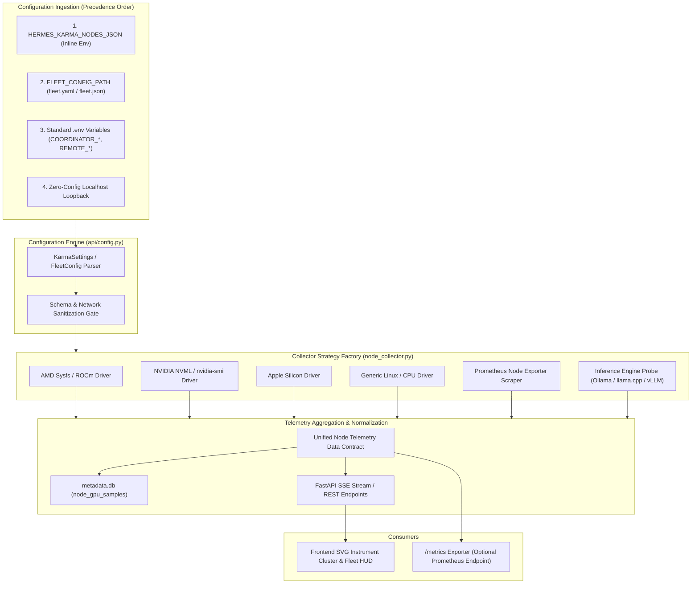

# Specification 08: Declarative Fleet Configuration, Universal Environment Portability & Cloud-Native Deployment

> **Tracking ID:** `SPEC-HK-008`  
> **Associated Tasks:** `TASK-HK-132` through `TASK-HK-136`  
> **Preceding Specs:** `SPEC-HK-001` (Multi-Node APU Telemetry), `SPEC-HK-006` (Fleet GPU History)  
> **Target Modules:** `api/config.py`, `api/services/node_collector.py`, `api/routes/nodes.py`, `api/static/app.js`, `api/static/index.html`, `Dockerfile`, `docker-compose.yml`, `deploy/k8s/`

---

## 1. Executive Summary & Problem Statement

`HermesKarma` was originally engineered with static node profiles tailored to specific homelab hardware (e.g. AMD Strix Halo APU workers and AMD SER8 coordinator nodes). While highly effective for a bespoke setup, this architecture presents hurdles when publishing as an open-source project or installing in new environments:
1. **Hardcoded Topology Constraints:** Expanding or modifying node definitions historically required editing Python dictionaries in `api/config.py` or matching specific hardcoded node IDs in `app.js` and `test_karma.py`.
2. **Hardware Uniformity Assumption:** The collector assumes Linux sysfs paths for AMD GPUs (`/sys/class/drm/card*/device/`) or Prometheus Node Exporter metrics tailored to AMD hardware, creating blind spots for users running NVIDIA GPUs, Apple Silicon Macs, Intel Arc, or CPU-only inference hosts.
3. **Rigid Ingress & File Dependencies:** Hermes Karma depends on local filesystem access to `~/.hermes/state.db` and writes to `~/.hermes_karma/metadata.db`. In containerized, headless, or Kubernetes cloud environments, directory paths must be strictly decoupled, mount-safe, and verifiable through standard 12-factor environment variables.

### 1.1 Objective & Scope
This specification defines the architecture, schema, and implementation plan to make `HermesKarma` **universally portable, trivially configurable, and cloud-ready**:
- **Declarative Fleet Configuration (`fleet.yaml` / `fleet.json`):** Support arbitrary $N$-node topologies (single laptop, multi-node homelab, or cloud k8s cluster) loaded from a structured config file or raw environment JSON (`HERMES_KARMA_NODES_JSON`).
- **Hardware-Agnostic Telemetry Engine:** An extensible collector plugin architecture supporting AMD sysfs, NVIDIA NVML/nvidia-smi, Apple Silicon `powermetrics`/`macmon`, Generic CPU/RAM, and generic Prometheus scrapers.
- **Strict 12-Factor Configuration:** Fully validated environment settings powered by Pydantic / python-dotenv with zero mandatory hardcoded defaults.
- **Automated Bootstrap Wizard (`karma init`):** A zero-dependency CLI discovery tool that probes local hardware, detects the Hermes Agent state directory, and scaffolds a working `.env` and `fleet.yaml`.
- **Production Containerization & Kubernetes Blueprint:** Multi-stage `Dockerfile`, rootless execution, `docker-compose.yml` for instant homelab boot, and reference Kubernetes manifests with read-only volume mounts and health probes.

---

## 2. Architecture & System Design



---

## 3. Specifications & Data Contracts

### 3.1 Declarative Fleet Schema (`fleet.yaml` / `fleet.json`)

The fleet configuration allows users to define any number of nodes, their roles, communication protocols, hardware profiles, and telemetry drivers.

```yaml
version: "1.0"
fleet:
  # Cluster-wide settings
  cache_ttl_sec: 10.0
  history_retention_days: 30

  # Node definitions
  nodes:
    # Example 1: Local Coordinator / Workstation Host
    - id: "local-node"
      name: "Workstation (Coordinator)"
      role: "coordinator"           # coordinator | worker | gateway
      is_local: true
      host: "localhost"
      driver: "auto"                 # auto | amdgpu | nvidia | apple_silicon | generic_linux
      inference:
        backend: "ollama"            # ollama | llamacpp | vllm | none
        port: 11434
        max_loaded_models: 2
      hardware:
        expected_vram_gb: 24.0
        gtt_size_mb: null
        tdp_limit_w: 250.0
        warning_temp_c: 80.0
        critical_temp_c: 90.0
      tags: ["coordinator", "workstation", "primary"]

    # Example 2: Remote NVIDIA GPU Inference Worker
    - id: "gpu-worker-01"
      name: "RTX 4090 Inference Rig"
      role: "worker"
      is_local: false
      host: "${GPU_WORKER_HOST:-192.168.1.50}"
      port: 8020
      driver: "nvidia"
      prometheus_exporter:
        enabled: true
        port: 9100
        path: "/metrics"
      inference:
        backend: "vllm"
        port: 8000
        metrics_path: "/metrics"
        max_loaded_models: 1
      hardware:
        expected_vram_gb: 24.0
        tdp_limit_w: 450.0
      tags: ["nvidia", "vllm", "tailscale"]

    # Example 3: Remote AMD Unified Memory APU Worker (e.g. Strix Halo / APU)
    - id: "apu-worker-01"
      name: "AMD Strix Halo Worker"
      role: "worker"
      is_local: false
      host: "${APU_WORKER_HOST:-}"
      tailscale_ip: "${APU_WORKER_TAILSCALE_IP:-}"
      driver: "amdgpu"
      prometheus_exporter:
        enabled: true
        port: 9100
      inference:
        backend: "llamacpp"
        port: 11434
        max_loaded_models: 1
      hardware:
        expected_vram_gb: 118.0
        gtt_size_mb: 120832
        tdp_limit_w: 120.0
      tags: ["amd-apu", "strix-halo", "llama-server"]
```

### 3.2 Pure Environment Variable Setup (Twelve-Factor & Kubernetes Ready)

When deploying in Docker or Kubernetes, a filesystem `fleet.yaml` can be omitted entirely in favor of environment variables:

1. **Option A: Inline JSON Specification (`HERMES_KARMA_NODES_JSON`)**
   ```bash
   HERMES_KARMA_NODES_JSON='[{"id":"coordinator","name":"Primary","host":"localhost","is_local":true,"driver":"auto"}]'
   ```
2. **Option B: Standard Parameterized Multi-Node Variables**
   ```bash
   # Coordinator Node
   COORDINATOR_NODE_ID=primary
   COORDINATOR_NODE_NAME="Local Coordinator"
   COORDINATOR_HOST=localhost
   LOCAL_OLLAMA_PORT=11434

   # Remote Worker Node 1
   WORKER_1_NODE_ID=gpu-rig
   WORKER_1_NODE_NAME="Inference Box"
   WORKER_1_HOST=192.168.1.100
   WORKER_1_DRIVER=nvidia
   WORKER_1_INFERENCE_PORT=8000
   WORKER_1_INFERENCE_BACKEND=vllm
   ```

### 3.3 Dynamic Hardware Prober & Telemetry Drivers

The `node_collector.py` module will transition from monolithic procedural functions to a **Strategy Pattern** with pluggable hardware drivers:

| Driver Name | Detection Signature | Metrics Collected | Fallback Strategy |
| :--- | :--- | :--- | :--- |
| **`amdgpu`** | `/sys/class/drm/card*/device/gpu_busy_percent` exists | GPU Core Busy %, GTT Alloc, VRAM Alloc, Power (W), Edge/Junction Temp (°C) | Falls back to Prometheus Node Exporter or sysfs hwmon |
| **`nvidia`** | `pynvml` importable or `nvidia-smi` binary available | GPU Util %, Memory Used/Total (GB), Power Draw (W), Fan Speed (%), GPU Temp (°C) | Queries NVIDIA DCGM / Prometheus exporter on port 9400 |
| **`apple_silicon`**| `sysctl hw.model` contains "Apple" / Darwin OS | Soc Power (W), Unified Memory Pressure, GPU Core Activity % | Reads `/proc/meminfo` equivalent via `vm_stat` and `ps` |
| **`generic_linux`**| Standard Linux host without discrete GPU | CPU Load (1m/5m/15m), Per-Core Util %, RAM Total/Used/Cached/Buffers, Swap | Reads `/proc/cpuinfo`, `/proc/meminfo`, `/proc/stat` |

### 3.4 Data Contract: Normalized Node Telemetry JSON

The existing frontend expects the cluster contract from `SPEC-HK-001`. The backend maintains 100% backward compatibility while normalizing fields across hardware vendors:

```json
{
  "node_id": "gpu-worker-01",
  "name": "RTX 4090 Inference Rig",
  "role": "worker",
  "driver": "nvidia",
  "is_local": false,
  "status": "online",
  "latency_ms": 12.4,
  "hardware": {
    "cpu": "AMD Ryzen 9 7950X",
    "gpu": "NVIDIA GeForce RTX 4090 (24GB)",
    "vram_gb": 24.0,
    "tdp_limit_w": 450.0
  },
  "amdgpu": {
    "available": true,
    "gpu_busy_percent": 74,
    "vram_total_gb": 24.0,
    "vram_used_gb": 18.2,
    "vram_used_percent": 75.8,
    "gtt_total_gb": 24.0,
    "gtt_used_gb": 18.2,
    "power_w": 310.5,
    "temperature_c": 62.0,
    "is_throttled": false,
    "oom_kills": 0,
    "device_path": "NVIDIA GeForce RTX 4090"
  },
  "apu_vram": {
    "total_gb": 24.0,
    "used_gb": 18.2,
    "free_gb": 5.8,
    "used_percent": 75.8
  },
  "inference_engine": {
    "backend_type": "vLLM",
    "running": true,
    "version": "vllm-v0.6.2",
    "loaded_models_count": 1,
    "max_loaded_models": 1,
    "overloaded": false,
    "loaded_models": [
      {
        "name": "meta-llama/Llama-3.1-70B-Instruct-AWQ",
        "size_gb": 18.2,
        "format": "awq",
        "parameter_size": "70B"
      }
    ],
    "slot_summary": {
      "total_slots": 4,
      "active_slots": 1,
      "idle_slots": 3
    }
  },
  "cluster_telltales": {
    "gear": "D",
    "active_slots": 1,
    "total_slots": 4,
    "is_generating": true,
    "is_throttled": false,
    "oom_alert": false,
    "tailscale_online": true
  }
}
```

---

## 4. Automated Bootstrap Wizard (`karma init`)

To deliver an exceptional onboarding experience, `HermesKarma` will provide a non-interactive and interactive bootstrapping script:
```bash
python3 -m api.setup
# or via entrypoint:
karma init
```

### 4.1 Bootstrap Actions:
1. **Locate Hermes State:**
   - Probes `$HERMES_HOME`, `~/.hermes/`, and common installation directories for `state.db`.
   - Checks read-only permissions and WAL mode status.
2. **Detect Hardware Topology:**
   - Checks for AMD GPU sysfs paths (`/sys/class/drm/`).
   - Checks for NVIDIA GPU via `nvidia-smi`.
   - Checks for macOS Apple Silicon unified memory.
   - Calculates total CPU cores and host physical memory.
3. **Probe Inference Backends:**
   - Tests local port `11434` (Ollama / llama-server) and port `8000` (vLLM / TGI).
   - Retrieves loaded model catalogs automatically.
4. **Scaffold Configuration:**
   - Writes a customized `.env` populated with local hardware values.
   - Generates `fleet.yaml` tailored to the discovered configuration.

---

## 5. Cloud-Native & Container Deployment Specification

### 5.1 Dockerfile (`Dockerfile`)
A production-grade, multi-stage, rootless container image:
- **Base:** `python:3.11-slim-bookworm`.
- **User:** Non-root system user `karma` (UID 1000).
- **Security:** Read-only root filesystem with ephemeral `/tmp` and `/app/run`.
- **Healthcheck:** Standard HTTP probe on `http://127.0.0.1:8020/api/nodes`.

### 5.2 Docker Compose (`docker-compose.yml`)
```yaml
version: "3.8"

services:
  hermes-karma:
    build: .
    image: ghcr.io/jagosan/hermes-karma:latest
    container_name: hermes-karma
    restart: unless-stopped
    ports:
      - "8020:8020"
    environment:
      - PORT=8020
      - HERMES_HOME=/data/hermes
      - HERMES_KARMA_HOME=/data/karma
      - FLEET_CONFIG_PATH=/data/karma/fleet.yaml
    volumes:
      # Mount Hermes agent database in read-only mode for safety
      - ${HOME}/.hermes:/data/hermes:ro
      # Mount Karma metadata directory for persistent tags/notes
      - ${HOME}/.hermes_karma:/data/karma:rw
      # Optional: Mount sysfs for hardware telemetry on Linux hosts
      - /sys:/sys:ro
    security_opt:
      - no-new-privileges:true
```

### 5.3 Kubernetes Cloud Deployment (`deploy/k8s/`)
For teams operating agent swarms in cloud Kubernetes environments:
- **`deployment.yaml`:** 1 Replica (SQLite WAL read-only access), liveness and readiness probes (`/api/nodes`).
- **`configmap.yaml`:** Carries `fleet.yaml` and environment overrides.
- **`service.yaml`:** Exposes port 8020 as `ClusterIP` or `LoadBalancer`.
- **Volume Mounts:** Support NFS / CIFS / CephFS / HostPath for mounting shared Hermes agent volumes across pods.

---

## 6. Phased Implementation Plan & Verification

### Phase 1: Declarative Fleet Schema & Dynamic Config Parser (`TASK-HK-132`)
- Create `api/schemas/fleet.py` defining Pydantic models for `NodeConfig`, `FleetConfig`, and `HardwareConfig`.
- Refactor `api/config.py` to load `fleet.yaml`, `fleet.json`, `HERMES_KARMA_NODES_JSON`, or `.env` in clean precedence order.
- Verify tests pass with 0 configured nodes, 1 local node, and $N$ remote nodes.

### Phase 2: Extensible Hardware Drivers (`TASK-HK-133`)
- Decouple `NodeTelemetryCollector` in `api/services/node_collector.py` into driver subclasses (`AmdGpuDriver`, `NvidiaGpuDriver`, `AppleSiliconDriver`, `GenericLinuxDriver`).
- Implement dynamic driver selection (`driver: auto`).
- Add safe timeouts and non-blocking asynchronous probes.

### Phase 3: Bootstrap Wizard CLI (`TASK-HK-134`)
- Implement `api/setup.py` (`python3 -m api.setup`).
- Auto-detect local GPU/CPU hardware and running Ollama/llama-server/vLLM processes.
- Scaffold `.env` and `fleet.yaml` cleanly.

### Phase 4: Containerization & Cloud Deployment (`TASK-HK-135`)
- Author `Dockerfile`, `.dockerignore`, and `docker-compose.yml`.
- Author sample Kubernetes manifests in `deploy/k8s/`.
- Test Docker image build and live execution mounting sample state database.

### Phase 5: Test Suite, Documentation & Quality Gate (`TASK-HK-136`)
- Author unit tests in `tests/test_karma.py` validating `fleet.yaml` parsing, driver fallbacks, and env override precedence.
- Update `README.md` with "Homelab & Cloud Deployment Guide".
- Update `docs/MAP.md`.

---

## 7. Success Criteria & Quality Gates

1. **Zero Hardcoded Nodes:** All node IDs, telemetry URLs, and hardware limits are derived exclusively from config files or environment variables.
2. **Instant Local Start:** Running `python3 -m api.main` on any fresh Linux or macOS machine with `~/.hermes/state.db` boots cleanly without configuration errors.
3. **NVIDIA & AMD Parity:** NVIDIA GPU hosts display accurate core load %, VRAM usage %, power draw, and temperature on the automotive instrument cluster gauges without frontend errors.
4. **Container Reproducibility:** Running `docker compose up` brings up the dashboard on `http://localhost:8020` with zero host-dependent path assumptions.
5. **100% Test Coverage:** All 38+ existing tests pass with new test coverage for declarative fleet validation.
