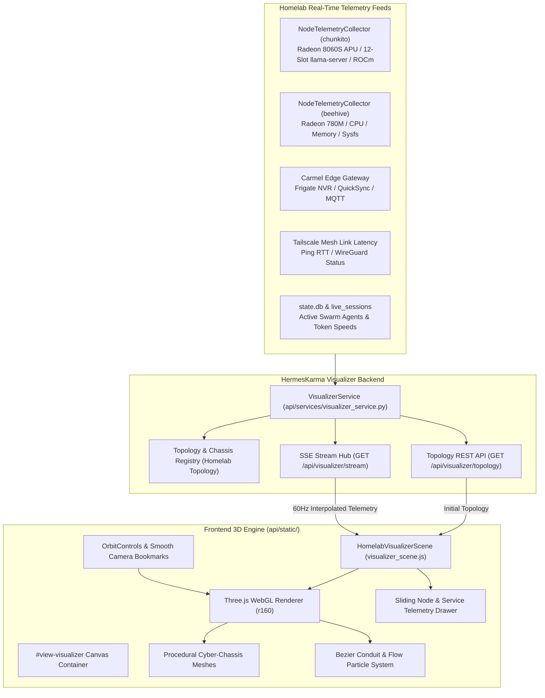

# Specification 09: Homelab 3D Spatial Visualizer (Interactive Hardware Topology, Translucent Node Chassis & Real-Time Flow Conduits)

> **Tracking ID:** `SPEC-HK-009`  
> **Associated Tasks:** `TASK-HK-137` through `TASK-HK-142`  
> **Preceding Specs:** `SPEC-HK-001` (Multi-Node APU Telemetry), `SPEC-HK-006` (Fleet GPU History), `SPEC-HK-008` (Declarative Fleet Configuration)  
> **Target Modules:** `api/routes/visualizer.py`, `api/services/visualizer_service.py`, `api/static/visualizer_scene.js`, `api/static/index.html`, `api/static/app.js`, `docs/architecture/09-homelab-3d-cluster-visualizer.md`, `docs/MAP.md`

---

## 1. Executive Summary & Problem Statement

`HermesKarma` currently visualizes homelab telemetry through 2D tabular cards, timeseries charts (Chart.js), and SVG automotive instrument clusters (SPEC-HK-005). While highly informative for numerical inspection, this flat interface fails to communicate the **spatial relationships, real-time data flows, and physical hardware form factors** of the distributed homelab ecosystem.

In parallel, the companion `Cluster Visualizer` (`cluster-vis`) project established a rich interactive 3D WebGL engine (Three.js) for Kubernetes topology exploration, featuring animated Bezier conduits, dynamic packet flow particles, semantic Level-of-Detail (LOD), camera orbit controls, and real-time streaming operators. However, `cluster-vis` utilizes an urban skyscraper architectural metaphor (ingress roofs, supervisor penthouses, and worker node floor trays) that does not reflect physical homelab machines.

### 1.1 Objective & Metaphor Evolution
This specification defines the architecture, data contracts, and implementation plan for a new **Homelab 3D Spatial Visualizer** view in `HermesKarma`. 

We replace the abstract "building/skyscraper" metaphor with a **Translucent Cyber-Chassis & Living Silicon** architectural language:
1. **Universal Open-Source Portability & Declarative Hardware Archetypes:** Because `HermesKarma` is an open-source project designed for arbitrary fleet topologies (SPEC-HK-008), the 3D visualizer is fundamentally hardware-agnostic and never locked to a single homelab setup. It defines a declarative chassis taxonomy with first-class procedural 3D models for universal hardware archetypes:
   - **`mini_pc` (Default Mini-PC):** Compact squircle with top mesh vents, visible motherboard, and glowing APU/iGPU die (Beelink, Intel NUC, Mac Mini, Geekom, Minisforum).
   - **`tower` (Default Desktop Tower / Workstation):** Vertical or mid-tower SFF chassis with front I/O ports, dual cooling exhaust fans, PSU bay, and a discrete PCIe GPU or high-memory APU accelerator bay (custom desktop PCs, AI workstations, enterprise SFFs).
   - **`phone` (Default Smartphone / Mobile Endpoint):** Sleek rectangular rounded glass slab with edge frame and glowing OLED touch surface (Pixel, iPhone, Galaxy, Android/iOS clients).
   - **`laptop` (Default Clamshell / Handheld):** Base keyboard/trackpad tray + angled backlit display lid (MacBooks, ThinkPads, GPD handhelds, Steam Deck).
   - **`tablet` (Default Thin Tablet / Digital Paper):** Ultra-thin flat slab with border bezels (iPads, reMarkable, Surface, Galaxy Tab).
   - **`server_rack` (Default 1U/2U Rackmount Server):** Horizontal rack chassis with front hot-swap drive bays and rack-mount ears.
2. **Physical Machine Faithful Geometries:** Users can configure any node via `fleet.yaml` or `HERMES_KARMA_NODES_JSON` using these archetype shapes, or enable specialized styling variants (e.g. Minisforum MS-S1 Max, Beelink SER8/EQi, GPD Win Max 2, reMarkable 2, Pixel 9 Pro).
3. **Visible Interior Silicon & Hardware Telemetry:** Translucent frosted outer shells reveal interior computing hardware—active CPU/APU silicon dies glowing with real-time compute load, 3D volumetric VRAM allocation pools, NVMe flash activity indicators, and thermal exhaust vent gradients.
4. **Real-Time Dynamic Data Conduits:** Animated 3D Bezier curves span the spatial volume between connected nodes, with photon/packet particles streaming between machines (e.g. LLM prompt context & token decode streams between inference nodes and coordinators, Syncthing vault sync pulses, OCR batch bursts, surveillance event streams).
5. **Docked Micro-Service Modules:** Software daemons and containers (Hermes Runtime, Karma, llama-server, vLLM, Ollama, Neo4j, Frigate NVR, SilverBullet, Syncthing) are visualized as modular components docked to each physical chassis, color-coded by real-time health and execution status.
6. **Interactive Spatial Navigation & Detail Zoom:** Orbit, pan, and pinch-to-zoom camera controls with smooth lerping. Clicking or double-clicking any machine focuses the camera into an isometric hero angle and smoothly slides out a deep telemetry inspector drawer.

---

## 2. Architecture & System Design



---

## 3. Universal Hardware Archetypes & Procedural Cyber-Chassis

To guarantee that `HermesKarma` is completely decoupled from any single user's environment and works out-of-the-box for any public user deploying `fleet.yaml` or `HERMES_KARMA_NODES_JSON`, the 3D visualizer defines a **declarative, universal hardware archetype taxonomy**.

Instead of requiring pre-baked 3D asset downloads (glTF/OBJ) or assuming specific proprietary machines, the visualizer procedurally constructs stylized, semi-transparent cyber-chassis geometries using core Three.js primitives and physical shaders.

### 3.1 Core Open-Source Hardware Archetypes

Every node configured in Hermes Karma maps to one of six core hardware archetypes, with default procedural renderings optimized for instant sub-100ms client hydration:

| Archetype (`chassis_type`) | Real-World Hardware Scope | Procedural 3D Geometry & Dimensions | Translucent Materials & Styling | Internal Living Silicon & Indicators |
| :--- | :--- | :--- | :--- | :--- |
| **`mini_pc`**<br/>*(Default Homelab Workhorse)* | Beelink SER/EQ, Intel NUC, Apple Mac Mini, Minisforum, Geekom, Asus PN series. | Compact squircle (rounded box): $W=2.6, H=0.9, D=2.6$, corner radius $r=0.25$. Top circular mesh cooling grille ($r=0.8$). | Frosted silver-aluminum shell (`metalness: 0.75`, `roughness: 0.25`, `transmission: 0.55`, `opacity: 0.78`). | Cyan-glowing motherboard substrate, dual glowing DDR5 RAM SODIMMs, central CPU/APU silicon die pulsing with compute load. |
| **`tower`**<br/>*(Desktop / AI Workstation / SFF)* | Custom ATX/mATX gaming PCs, AI workstations, Minisforum MS-S1/MS-01, Dell Precision, HP Z-series. | Vertical/SFF workstation tower: $W=4.2, H=1.6, D=3.8$, dual lateral exhaust intake fins, rear 10GbE copper I/O bay, front power cluster. | Industrial matte obsidian shell with smoked glass top/side window (`roughness: 0.18`, `transmission: 0.65`, `opacity: 0.82`, amber edge rim). | Giant central APU/GPU die ($1.2 \times 1.2$) or discrete PCIe accelerator bay; 12 peripheral memory blocks representing inference slots or GPU VRAM banks. |
| **`phone`**<br/>*(Smartphone / Mobile Client)* | Google Pixel, Apple iPhone, Samsung Galaxy, generic Android/iOS client endpoints. | Curved rectangular smartphone slab: $W=0.9, H=0.1, D=1.8$, raised camera visor/island ($W=0.92, H=0.14, D=0.3$). | Polished obsidian glass front and back (`metalness: 0.9`, `roughness: 0.1`, `transmission: 0.4`), matte metal perimeter frame. | Edge-to-edge OLED screen glowing softly with Syncthing, WebSocket, and push sync indicator pulses. |
| **`laptop`**<br/>*(Mobile Dev Workstation / Handheld)* | MacBook Pro/Air, ThinkPad, Dell XPS, GPD Win Max, Steam Deck, ASUS ROG Ally. | Clamshell hybrid: Base tray ($W=2.2, H=0.35, D=1.6$) + hinged display lid ($W=2.2, H=1.5, D=0.1$) tilted at $110^\circ$. | Matte gunmetal magnesium alloy; translucent keyboard deck with backlit keys and trackpad/gamepad accents. | Glowing display panel emitting soft code/terminal grid luminescence; internal APU core. |
| **`tablet`**<br/>*(Digital Paper / Touch Slate)* | reMarkable 2, Apple iPad, Samsung Galaxy Tab, Microsoft Surface. | Ultra-thin slab: $W=2.0, H=0.08, D=2.7$ ($4.7\text{mm}$ scaled profile), vertical edge rail spine. | Paper-white or slate matte finish (`roughness: 0.85`, `metalness: 0.05`), brushed metal edge rail. | Monochrome or OLED surface displaying stroke ripple animations and document sync bursts. |
| **`server_rack`**<br/>*(1U/2U Rackmount Server)* | Dell PowerEdge, Supermicro, HP ProLiant, custom 19-inch homelab rackmount chassis. | Horizontal low-profile rack unit: $W=4.8, H=0.8, D=4.2$, front rack-mount ears, hot-swap drive bays. | Dark brushed steel chassis, front drive caddy LED arrays (green read, amber write). | Dual redundant PSU glow in rear, multi-core enterprise CPU dies, PCIe riser card indicators. |

### 3.2 Automatic Archetype Inference Engine

When users deploy `HermesKarma` without authoring explicit 3D visualizer configurations, `VisualizerService` inspects the node's existing `hardware`, `tags`, and `role` fields (from SPEC-HK-008 declarative fleet configuration) and dynamically infers the optimal default archetype:

```python
def infer_chassis_type(node: Dict[str, Any]) -> str:
    """Infer procedural 3D chassis archetype from declarative node telemetry."""
    if "chassis_type" in node:
        return node["chassis_type"]
    
    tags = set(t.lower() for t in node.get("tags", []))
    hw = node.get("hardware", {})
    gpu_desc = str(hw.get("gpu", "")).lower()
    role = str(node.get("role", "")).lower()
    
    # 1. Mobile & Client Endpoints
    if any(t in tags for t in ["phone", "mobile", "android", "ios", "pixel", "iphone"]):
        return "phone"
    if any(t in tags for t in ["tablet", "e-ink", "remarkable", "ipad"]):
        return "tablet"
    if any(t in tags for t in ["laptop", "handheld", "clamshell", "macbook", "bazzite"]):
        return "laptop"
        
    # 2. Enterprise & Rackmount Servers
    if any(t in tags for t in ["rack", "1u", "2u", "supermicro", "poweredge"]):
        return "server_rack"
        
    # 3. High-Power Desktop Towers & AI Workstations
    # Conditions: Discrete PCIe GPU, massive VRAM (>64GB), or heavy inference worker role
    if (hw.get("vram_gb", 0) >= 64 or 
        any(k in gpu_desc for k in ["rtx", "geforce", "quadro", "a100", "h100", "8060s", "strix"]) or
        any(t in tags for t in ["tower", "desktop", "workstation", "strix-halo", "heavy_inference"])):
        return "tower"
        
    # 4. Universal Default for Homelab Nodes
    # Compact Mini-PCs (Beelink, NUC, Mac Mini, SER8, EQi)
    return "mini_pc"
```

### 3.3 Reference Homelab Specializations (Bespoke Presets)

For users with specific hardware matching known devices, the visualizer supports optional subtype specializations (`chassis_variant`):
- `mini_pc` can specialize into `beelink_ser8` (circular top mesh) or `beelink_eqi` (dual RJ45 surveillance gateway).
- `tower` can specialize into `minisforum_ms_s1_max` (dual lateral exhaust fin stacks, 12-slot APU ring) or `generic_tower`.
- `laptop` can specialize into `gpd_win_max_2` (split handheld thumbsticks) or `generic_laptop`.
- `tablet` can specialize into `remarkable_2` (CANVAS e-ink texture & left spine) or `generic_tablet`.
- `phone` can specialize into `pixel_9_pro` (horizontal camera visor bar) or `generic_phone`.

If an unknown `chassis_variant` is provided, the renderer gracefully falls back to the parent archetype's procedural model.

```
[ Homelab 3D Spatial Datum Plane: Y = 0 ]

        (Mobile Edge)                          (Capitola Primary Cluster)
    ┌──────────────────────┐                ┌──────────────────────────────┐
    │  tablet: reMarkable  │◄───OCR Stream──┤  mini_pc: Beelink SER8       │
    │  [archetype: tablet] │                │  (beehive: coordinator)      │
    └──────────────────────┘                │  - Ryzen 7 8845HS / 780M     │
                                            │  - Hermes / Karma / Neo4j    │
    ┌──────────────────────┐                └──────────────┬───────────────┘
    │  laptop: Win Max 2   │                               │
    │  [archetype: laptop] │◄──Syncthing Vault Sync────────┤
    │  - 7840U / Bazzite   │                               │ Inference Highway
    └──────────────────────┘                               │ (Tokens/s, 12 slots)
                                                           ▼
    ┌──────────────────────┐                ┌──────────────────────────────┐
    │  phone: Pixel 9 Pro  │◄──PWA / Sync───┤  tower: Minisforum MS-S1 Max │
    │  [archetype: phone]  │                │  (chunkito: APU Workstation) │
    └──────────────────────┘                │  - Strix Halo 128GB Unified  │
                                            │  - Radeon 8060S (40 CUs)     │
        (Carmel Valley Edge)                │  - llama-server ROCm 7.2.4   │
    ┌──────────────────────┐                └──────────────┬───────────────┘
    │  mini_pc: Beelink EQi│                               │
    │  [archetype: mini_pc]├───────Surveillance Cypher─────┘
    │  - Intel Core 3 304  │       Vision Verification Stream
    │  - Frigate QuickSync │
    └──────────────────────┘
```

---

## 4. Real-Time Dynamic Conduits & Flow Particle System

Inter-node network communication and data replication are represented by dynamic 3D Bezier conduits with flowing photon/packet particles:

### 4.1 Conduit Topologies & Color Semantics

| Conduit ID | Endpoints | Protocol & Workload | Base Color | Real-Time Dynamic Modulation |
| :--- | :--- | :--- | :--- | :--- |
| `conduit-inference` | `beehive` $\longleftrightarrow$ `chunkito` | **Inference & Swarm Stream**<br/>HTTP / Tailscale Direct Ethernet (:11434) | Cyan (`#00ffcc`) | **Particle Speed:** Scales with tokens/sec ($v = 0.5 + 0.05 \times \text{tok/s}$).<br/>**Particle Color:** Modulates from cool cyan (<30 tok/s) $\to$ vibrant emerald (30–80 tok/s) $\to$ burning amber/redline (>100 tok/s or prompt prefill burst). |
| `conduit-syncthing` | `beehive` $\longleftrightarrow$ `chubbs`<br/>`beehive` $\longleftrightarrow$ `pixel-9-pro` | **Obsidian Vault Sync**<br/>Syncthing Block Protocol (:22000) | Violet / Indigo (`#8b5cf6`) | **Particle Bursts:** Emits periodic packet clusters whenever vault file changes (`write_file`, `patch`) or syncthing file modifications occur. |
| `conduit-ocr` | `remarkable` $\longleftrightarrow$ `beehive` | **Digital Paper OCR Pipeline**<br/>Tailscale SSH / `remarkable-ocr.timer` | Emerald (`#10b981`) | **Batch Pulses:** Normally dormant faint wireframe; every 5 minutes (or on manual trigger), pulses with dense green stroke data flowing into Beehive. |
| `conduit-carmel` | `carmel-edge` $\longleftrightarrow$ `beehive` | **Surveillance Cypher Stream**<br/>Neo4j Driver / MQTT / Tailscale | Amber (`#f59e0b`) | **Event Sparkles:** Emits particle pulses whenever Frigate detects person/vehicle motion and commits triples to Neo4j. |
| `conduit-vision-verify` | `carmel-edge` $\longleftrightarrow$ `chunkito` | **Heavy Multimodal Fallback**<br/>Direct Vision API (:11434) | Crimson (`#ef4444`) | **Conditional Conduit:** Only illuminates when edge NPU requests offline deep vision verification on Chunkito's MoE models. |
| `mesh-datum-lattice` | All active nodes $\longrightarrow$ Ground | **Tailscale WireGuard Mesh**<br/>Virtual Datum Plane at $Y = 0$ | Muted Slate (`#334155`) | Subtle glowing hexagonal grid on the ground plane connecting node footprints, showing live ping RTT indicators (e.g. `1.2ms`, `28ms`). |

### 4.2 Mathematical Curve Definition
To prevent conduits from intersecting machine chassis or overlapping, conduits utilize 3D cubic Bezier curves with parametric clearance offsets:
$$\vec{B}(t) = (1-t)^3 \vec{P}_0 + 3(1-t)^2 t \vec{P}_1 + 3(1-t) t^2 \vec{P}_2 + t^3 \vec{P}_3 \quad (t \in [0, 1])$$
- $\vec{P}_0, \vec{P}_3$: Source and target machine I/O port coordinates.
- $\vec{P}_1 = \vec{P}_0 + \vec{u}_{\text{exit}} \cdot \delta_0 + \vec{e}_Y \cdot h_{\text{arc}}$ (Rises upward from source chassis).
- $\vec{P}_2 = \vec{P}_3 + \vec{u}_{\text{entry}} \cdot \delta_1 + \vec{e}_Y \cdot h_{\text{arc}}$ (Descends into target chassis).
- Arc height $h_{\text{arc}}$ is deterministically tiered based on conduit type to prevent visual tangling.

---

## 5. Live Telemetry & Hardware State Manifestations

The 3D scene directly reflects live machine state streamed via SSE:

### 5.1 GPU & Silicon Die Illumination
- **APU Core Emissive Shader:** The internal silicon die geometry of `chunkito` (Radeon 8060S) and `beehive` (Radeon 780M) utilizes dynamic emissive color and pulsing intensity:
  $$I_{\text{emissive}} = 0.2 + 0.8 \times \left(\frac{\text{gpu\_busy\_percent}}{100}\right) + 0.1 \times \sin(4\pi t)$$
- **VRAM Allocation Volume:** A 3D volumetric glass bar inside Chunkito fills proportionally from 0% to 100% based on `apu_vram.used_bytes / apu_vram.total_bytes`, color-coded cyan ($<70\%$), amber ($70–90\%$), or redline ($>90\%$).
- **Inference Slot Array (12 Slots):** Arranged as 12 modular micro-cubes surrounding the Strix Halo die.
  - `Idle`: Translucent dark slate (`#1e293b`).
  - `Prefill`: Pulsing rapid amber glow (`#f59e0b`).
  - `Decode`: Solid emerald green glow (`#10b981`) with frequency proportional to instantaneous tok/s.
  - `Exclusive Mode`: Deep purple glow (`#a855f7`) when Jagular (177B) or Heffalump (284B) locks all slots.

### 5.2 Docked Software Service Chips
Floating directly above or docked along the upper perimeter of each chassis are stylized hexagonal chips representing running services:
- **Beehive:** `Hermes Agent` (Port 8787), `Hermes Karma` (Port 8020), `Neo4j DB` (Port 7474), `Cloudflare Tunnel`, `SilverBullet` (Port 3000), `reMarkable Ingest Timer`.
- **Chunkito:** `llama-server ROCm` (Port 11434), `Woods Gate Daemon`, `Prometheus Node Exporter`.
- **Carmel Edge:** `Frigate NVR`, `go2rtc RTSP`, `Intel QuickSync VAAPI`, `Hermes Edge` (Port 8644), `Mosquitto MQTT`.
- **Chubbs:** `Bazzite OSTree`, `Syncthing Daemon`, `Distrobox Dev`, `NerdDictation`.
- **reMarkable:** `Codex OS`, `CANVAS Stroke DB`, `Tailscale SSH`.
- **Pixel 9 Pro:** `Syncthing Android`, `Hermes PWA`, `Telegram Bot Client`.

Service chips display a pulsing micro-LED status dot: Green = Healthy/Active, Amber = High Latency/Load, Red = Error/Down, Gray = Offline/Suspended.

---

## 6. Backend API & Telemetry Contract

### 6.1 Static Topology Contract (`GET /api/visualizer/topology`)
Returns the complete declarative homelab layout, node geometries, hardware capacities, docked services, and conduit definitions:

```json
{
  "datum_plane": { "size": [40, 40], "grid_spacing": 2.0, "color": "#1e293b" },
  "nodes": [
    {
      "id": "beehive",
      "name": "Beehive (Coordinator)",
      "chassis_type": "beelink_ser8",
      "position": [0.0, 0.45, 0.0],
      "rotation": [0.0, 0.0, 0.0],
      "hardware": {
        "cpu": "AMD Ryzen 7 8845HS (8C/16T)",
        "ram_gb": 32,
        "gpu": "AMD Radeon 780M (gfx1103)",
        "vram_gb": 16,
        "thermal_limit_c": 95
      },
      "services": [
        { "id": "hermes_runtime", "name": "Hermes Gateway", "port": 8787, "icon": "bot", "status": "active" },
        { "id": "hermes_karma", "name": "Hermes Karma", "port": 8020, "icon": "activity", "status": "active" },
        { "id": "neo4j", "name": "Neo4j Graph DB", "port": 7474, "icon": "database", "status": "active" },
        { "id": "cloudflared", "name": "Cloudflare Tunnel", "icon": "shield", "status": "active" },
        { "id": "silverbullet", "name": "SilverBullet Notes", "port": 3000, "icon": "file-text", "status": "active" },
        { "id": "remarkable_ocr", "name": "reMarkable OCR Timer", "icon": "pen-tool", "status": "active" }
      ]
    },
    {
      "id": "chunkito",
      "name": "Chunkito (APU Inference)",
      "chassis_type": "minisforum_ms_s1_max",
      "position": [7.0, 0.8, -2.0],
      "rotation": [0.0, -0.2, 0.0],
      "hardware": {
        "cpu": "AMD Ryzen AI Max+ 395 (16C/32T)",
        "ram_gb": 128,
        "gpu": "AMD Radeon 8060S (gfx1151, 40 CUs)",
        "vram_gb": 118,
        "inference_slots": 12,
        "thermal_limit_c": 100
      },
      "services": [
        { "id": "llama_server", "name": "ROCm llama-server", "port": 11434, "icon": "cpu", "status": "active" },
        { "id": "woods_gate", "name": "Woods Gate Daemon", "icon": "git-branch", "status": "active" }
      ]
    },
    {
      "id": "chubbs",
      "name": "Chubbs (GPD Win Max 2)",
      "chassis_type": "gpd_win_max_2",
      "position": [-6.0, 0.2, 3.0],
      "rotation": [0.0, 0.35, 0.0]
    },
    {
      "id": "remarkable",
      "name": "reMarkable 2",
      "chassis_type": "remarkable_2",
      "position": [-5.5, 0.05, -4.5],
      "rotation": [-1.57, 0.0, 0.2]
    },
    {
      "id": "carmel_edge",
      "name": "Carmel Edge (Beelink EQi)",
      "chassis_type": "beelink_eqi",
      "position": [6.5, 0.4, 5.5],
      "rotation": [0.0, -0.4, 0.0]
    },
    {
      "id": "pixel_9_pro",
      "name": "Google Pixel 9 Pro",
      "chassis_type": "pixel_9_pro",
      "position": [-2.0, 0.05, 5.0],
      "rotation": [-1.57, 0.0, -0.1]
    }
  ],
  "conduits": [
    {
      "id": "inference_highway",
      "type": "inference",
      "source_node": "beehive",
      "target_node": "chunkito",
      "label": "LLM Inference Highway (12 Slots)",
      "arc_height": 2.2,
      "base_color": "#00ffcc"
    },
    {
      "id": "vault_sync_chubbs",
      "type": "syncthing",
      "source_node": "beehive",
      "target_node": "chubbs",
      "label": "Syncthing Obsidian Vault Sync",
      "arc_height": 1.4,
      "base_color": "#8b5cf6"
    },
    {
      "id": "ocr_ingest_remarkable",
      "type": "ocr_batch",
      "source_node": "remarkable",
      "target_node": "beehive",
      "label": "reMarkable Stroke OCR Pipeline",
      "arc_height": 1.6,
      "base_color": "#10b981"
    },
    {
      "id": "carmel_surveillance_neo4j",
      "type": "surveillance",
      "source_node": "carmel_edge",
      "target_node": "beehive",
      "label": "Frigate NVR Event Cypher Triples",
      "arc_height": 1.8,
      "base_color": "#f59e0b"
    }
  ]
}
```

### 6.2 Real-Time SSE Telemetry Stream (`GET /api/visualizer/stream`)
Broadcasts lightweight deltas at 1Hz (with client-side 60Hz tween interpolation):

```json
{
  "timestamp": 1729580400.12,
  "nodes": {
    "chunkito": {
      "online": true,
      "cpu_pct": 24.5,
      "gpu_busy_pct": 88.0,
      "temperature_c": 64.0,
      "power_w": 92.4,
      "vram_used_gb": 98.2,
      "vram_total_gb": 118.0,
      "inference": {
        "resident_model": "Qwen3-Coder-30B-A3B-Instruct (262k)",
        "instant_tok_per_sec": 64.2,
        "slots_active": 4,
        "slots_total": 12,
        "slots": [
          { "slot_id": 0, "status": "decoding", "persona": "tigger", "tok_per_sec": 58.4 },
          { "slot_id": 1, "status": "decoding", "persona": "pooh", "tok_per_sec": 61.2 },
          { "slot_id": 2, "status": "prefill", "persona": "jagular", "tok_per_sec": 1180.0 },
          { "slot_id": 3, "status": "decoding", "persona": "piglet", "tok_per_sec": 64.0 },
          { "slot_id": 4, "status": "idle" }
        ]
      }
    },
    "beehive": {
      "online": true,
      "cpu_pct": 18.2,
      "gpu_busy_pct": 12.0,
      "temperature_c": 51.0,
      "power_w": 28.5,
      "ram_used_gb": 14.8,
      "ram_total_gb": 32.0
    }
  },
  "conduits": {
    "inference_highway": {
      "activity_level": 0.88,
      "tokens_per_sec": 247.8,
      "latency_ms": 1.4,
      "surge": false
    },
    "vault_sync_chubbs": {
      "activity_level": 0.15,
      "bytes_per_sec": 14200,
      "latency_ms": 14.2
    }
  }
}
```

---

## 7. Frontend Integration & Interactive Controls

### 7.1 DOM Structure (`index.html`)
A new navigation tab `#tab-visualizer` and viewport container `#view-visualizer`:

```html
<!-- Tab button in desktop navbar & mobile drawer -->
<button onclick="switchTab('visualizer')" id="tab-visualizer" class="tab-btn ...">
  <i data-lucide="box" class="w-4 h-4"></i>
  <span>Homelab 3D</span>
</button>

<!-- Main View Container -->
<div id="view-visualizer" class="tab-view hidden relative w-full h-[calc(100vh-70px)] bg-dark-950 overflow-hidden select-none">
  <!-- Three.js Canvas Mount Point -->
  <canvas id="homelabVisualizerCanvas" class="w-full h-full block"></canvas>

  <!-- Top Floating Glass HUD -->
  <div class="absolute top-4 left-4 right-4 z-20 flex items-center justify-between pointer-events-none">
    <div class="flex items-center space-x-3 pointer-events-auto">
      <div class="px-4 py-2 rounded-xl bg-dark-900/80 backdrop-blur-md border border-slate-700/60 shadow-2xl flex items-center space-x-3">
        <span class="w-2.5 h-2.5 rounded-full bg-emerald-500 animate-pulse"></span>
        <span class="text-xs font-semibold text-slate-200">Homelab Spatial Mesh</span>
        <span class="text-xs text-slate-400 font-mono" id="visStatusNodeCount">6 Nodes</span>
      </div>
      <div class="px-3 py-2 rounded-xl bg-dark-900/80 backdrop-blur-md border border-slate-700/60 flex items-center space-x-2">
        <span class="text-xs text-slate-400">Total VRAM:</span>
        <span class="text-xs font-mono font-bold text-cyan-400" id="visStatusVram">98.2 / 134 GB</span>
      </div>
      <div class="px-3 py-2 rounded-xl bg-dark-900/80 backdrop-blur-md border border-slate-700/60 flex items-center space-x-2">
        <span class="text-xs text-slate-400">Inference:</span>
        <span class="text-xs font-mono font-bold text-emerald-400" id="visStatusToks">247.8 tok/s</span>
      </div>
    </div>

    <!-- View Mode & Camera Toggles -->
    <div class="flex items-center space-x-2 pointer-events-auto">
      <button onclick="visResetCamera()" class="p-2 rounded-lg bg-dark-900/80 backdrop-blur border border-slate-700/60 text-slate-300 hover:text-white" title="Reset Camera">
        <i data-lucide="rotate-ccw" class="w-4 h-4"></i>
      </button>
      <button onclick="visToggleAutoRotate()" id="btnVisAutoRotate" class="p-2 rounded-lg bg-dark-900/80 backdrop-blur border border-slate-700/60 text-slate-300 hover:text-white" title="Toggle Orbit">
        <i data-lucide="orbit" class="w-4 h-4"></i>
      </button>
      <div class="flex bg-dark-900/80 backdrop-blur rounded-lg border border-slate-700/60 p-0.5">
        <button onclick="visSetLayout('spatial')" id="visBtnSpatial" class="px-3 py-1 text-xs font-semibold rounded bg-brand-600 text-white">Spatial</button>
        <button onclick="visSetLayout('topology')" id="visBtnTopology" class="px-3 py-1 text-xs font-semibold text-slate-400 hover:text-slate-200">Topology</button>
      </div>
    </div>
  </div>

  <!-- Right Sliding Telemetry & Service Inspector Drawer -->
  <div id="visInspectorDrawer" class="absolute top-4 bottom-4 right-4 w-96 rounded-2xl bg-dark-900/90 backdrop-blur-xl border border-slate-700/70 shadow-2xl z-30 transform translate-x-[110%] transition-transform duration-300 ease-out flex flex-col p-5 overflow-hidden">
    <!-- Header with close button -->
    <div class="flex items-center justify-between pb-4 border-b border-slate-800">
      <div class="flex items-center space-x-3">
        <div id="visDrawerIcon" class="w-8 h-8 rounded-lg bg-brand-500/20 text-brand-400 flex items-center justify-center"></div>
        <div>
          <h3 id="visDrawerTitle" class="font-bold text-sm text-white">Node Name</h3>
          <p id="visDrawerSub" class="text-xs text-slate-400 font-mono">Hardware Model</p>
        </div>
      </div>
      <button onclick="visCloseDrawer()" class="p-1.5 rounded-lg text-slate-400 hover:text-white hover:bg-slate-800">
        <i data-lucide="x" class="w-4 h-4"></i>
      </button>
    </div>

    <!-- Drawer Content Scrollable Area -->
    <div id="visDrawerBody" class="flex-1 overflow-y-auto space-y-4 pt-4 pr-1">
      <!-- Live Instrument Gauges, VRAM, Temperature, Services List, Inference Slots -->
    </div>
  </div>

  <!-- Bottom Conduit Flow Controls -->
  <div class="absolute bottom-4 left-4 z-20 pointer-events-auto flex items-center space-x-3 bg-dark-900/80 backdrop-blur-md px-4 py-2 rounded-xl border border-slate-700/60 shadow-lg">
    <span class="text-xs text-slate-400">Particle Speed:</span>
    <input type="range" min="0.2" max="3.0" step="0.1" value="1.0" oninput="visSetSpeed(this.value)" class="w-24 accent-brand-500">
    <div class="h-4 w-[1px] bg-slate-700"></div>
    <span class="text-xs text-slate-400 font-mono" id="visFpsReadout">60 FPS</span>
  </div>
</div>
```

---

## 8. Implementation Phases & Task Breakdown

```mermaid
gantt
    title SPEC-HK-009 Implementation Workstreams
    dateFormat  YYYY-MM-DD
    section Backend
    TASK-HK-137: Topology Model & SSE Telemetry Stream  :a1, 2026-10-23, 1d
    section 3D Engine
    TASK-HK-138: Procedural Translucent Chassis Geometries:a2, after a1, 2d
    TASK-HK-139: Dynamic Bezier Conduits & Flow Particles  :a3, after a2, 1d
    section Frontend
    TASK-HK-140: 3D Viewport, Camera Director & Inspector :a4, after a3, 1d
    section QA & Verification
    TASK-HK-141: Unit & Integration Test Suite           :a5, after a4, 1d
    TASK-HK-142: Security Review, MAP.md & Production Sync:a6, after a5, 1d
```

### 8.1 Detailed Task Specifications

#### Phase 1: Backend Data Model, Topology Specification & SSE Stream
- **Ticket:** `TASK-HK-137`
- **Assignee:** `@tigger` / `@owl`
- **Deliverables:**
  1. Create `api/services/visualizer_service.py`:
     - Maintain declarative homelab topology registry (`beehive`, `chunkito`, `chubbs`, `remarkable`, `carmel-edge`, `pixel-9-pro`).
     - Support dynamic coordinate lerping for Spatial Layout vs Force-Directed Network Topology.
     - Integrate with `NodeTelemetryCollector` to extract real-time GPU busy %, temperature, power, and VRAM.
     - Extract live inference token speed and 12-slot status from Chunkito's llama-server `/metrics` and `/slots`.
  2. Create REST route `api/routes/visualizer.py`:
     - `GET /api/visualizer/topology`: Returns static nodes, chassis specs, services, and conduit curves.
     - `GET /api/visualizer/stream`: Async Server-Sent Events (SSE) stream emitting 1Hz telemetry deltas.
  3. Register visualizer router in `api/main.py`.

#### Phase 2: Procedural 3D Hardware Geometries & Translucent Cyber-Chassis
- **Ticket:** `TASK-HK-138`
- **Assignee:** `@tigger`
- **Deliverables:**
  1. Author `api/static/visualizer_scene.js` using Three.js (r160):
     - Implement core procedural geometry generators for open-source hardware archetypes:
       - `buildMiniPcMesh()`: Universal compact mini-PC squircle with top circular/slotted mesh cooling grille, translucent shell, motherboard plane, dual SODIMM RAM sticks, and central CPU/APU die.
       - `buildTowerMesh()`: Universal desktop tower / SFF workstation with dual cooling fans, front I/O ports, PSU bay, and discrete PCIe accelerator bay or 12-slot APU ring.
       - `buildPhoneMesh()`: Universal smartphone slab with rounded corners, camera bump/visor, perimeter metal band, and glowing OLED touch display.
       - `buildLaptopMesh()`: Universal clamshell laptop/handheld with base keyboard/trackpad tray and angled backlit display screen.
       - `buildTabletMesh()`: Universal thin tablet / digital paper slate with border bezels and screen surface.
       - `buildServerRackMesh()`: Universal 1U/2U horizontal rackmount server with front drive caddies and rack-mount ears.
     - Implement specialized homelab preset styling variants (`beelink_ser8`, `minisforum_ms_s1_max`, `gpd_win_max_2`, `remarkable_2`, `beelink_eqi`, `pixel_9_pro`) extending the core archetype primitives.
     - Implement dynamic archetype fallback: unknown or unspecified nodes automatically resolve to `infer_chassis_type()` archetypes.
  2. Implement translucent frosted cyber-materials (`MeshPhysicalMaterial`) with glowing edge accents and interior silicon die illumination.
  3. Attach docked hexagonal service chips hovering above each chassis with live health status LEDs.

#### Phase 3: Dynamic 3D Bezier Conduits & Flow Particle System
- **Ticket:** `TASK-HK-139`
- **Assignee:** `@tigger`
- **Deliverables:**
  1. Implement Bezier curve conduit generator in `visualizer_scene.js`:
     - Calculate collision-free 3D cubic Bezier paths between connected nodes.
     - Support tiered vertical arc heights ($h_{\text{arc}}$) preventing conduit overlap.
  2. Implement `HomelabFlowParticleSystem`:
     - Batch-rendered photon particles flowing along curves using `THREE.InstancedMesh` for peak 60 FPS performance.
     - Modulate particle velocity proportionally with real-time tokens/sec ($v \propto \text{tok/s}$) on the Chunkito $\longleftrightarrow$ Beehive inference highway.
     - Color modulation: Cyan (<30 tok/s) $\to$ Emerald (30–80 tok/s) $\to$ Amber/Crimson (>100 tok/s or prompt prefill burst).
     - Discrete batch cluster bursts for Syncthing vault sync and reMarkable OCR events.
  3. Render subtle glowing Tailscale WireGuard mesh lattice on the ground datum plane ($Y=0$) with dynamic ping latency badges.

#### Phase 4: UI Viewport, OrbitControls, Camera Tweens & Sliding Telemetry Inspector
- **Ticket:** `TASK-HK-140`
- **Assignee:** `@tigger`
- **Deliverables:**
  1. Update `api/static/index.html`:
     - Add `#tab-visualizer` tab in top navbar and mobile drawer with Lucide `box` icon.
     - Add `#view-visualizer` canvas container, top floating glass HUD, bottom particle speed slider, and right sliding drawer `#visInspectorDrawer`.
  2. Update `api/static/app.js`:
     - Wire tab switching logic for `switchTab('visualizer')` with automatic WebGL resize triggers (`renderer.setSize`).
     - Implement Three.js `OrbitControls` with damping, distance bounds ($5.0 \le d \le 35.0$), and mobile touch support.
     - Implement Raycaster click detection: clicking any chassis triggers smooth camera tween focusing on that node at an isometric hero angle and opens `#visInspectorDrawer`.
     - Populate drawer with real-time hardware gauges, loaded model, 12-slot status breakdown, and running service cards.
     - Implement Layout switch (Spatial Physical Layout $\longleftrightarrow$ Network Topology).

#### Phase 5: Comprehensive Automated Test Suite
- **Ticket:** `TASK-HK-141`
- **Assignee:** `@piglet`
- **Deliverables:**
  1. Author `tests/test_visualizer.py`:
     - Test `GET /api/visualizer/topology` for schema completeness (validates 6 nodes, correct hardware specs, and 4 conduits).
     - Test `GET /api/visualizer/stream` SSE generator, verifying live payload formatting and fallback safety when remote nodes are unreachable.
     - Verify slot normalization logic (ensures 12 slots are mapped correctly for Chunkito).
  2. Execute test suite under Python 3.14 venv: `env -u PYTHONPATH .venv/bin/python3 -m pytest tests/test_visualizer.py tests/test_karma.py`.

#### Phase 6: Documentation, MAP.md Registration & Production Deployment Gate
- **Ticket:** `TASK-HK-142`
- **Assignee:** `@jagular` / `@owl`
- **Deliverables:**
  1. Author companion architectural blueprint: `docs/architecture/09-homelab-3d-cluster-visualizer.md`.
  2. Register SPEC-HK-009, routes, and DOM elements in `docs/MAP.md`.
  3. Verify security invariants: Zero public exposure of private Tailscale IPs, sanitized endpoints.
  4. Restart production user systemd service: `systemctl --user restart hermes-karma.service`.
  5. Commit and push clean diffs to `origin/main`.

---

## 9. Verification & Acceptance Criteria

1. **Procedural Physical Faithfulness:** The 3D scene renders 6 distinct machine geometries with recognizable form factors (SER8 squircle, MS-S1 Max dual vents, Win Max 2 clamshell, reMarkable tablet slab, EQi gateway, Pixel 9 Pro visor). No generic skyscraper or building primitives are present.
2. **Silicon & Hardware Activity Transparency:** Chunkito's translucent chassis displays the internal Strix Halo APU die and 12 inference slot cubes reflecting real-time slot state (idle, prefill, decode) and live VRAM fill. Beehive displays the glowing 780M iGPU core and memory banks.
3. **Dynamic Conduit Physics:** Flowing particles along the Beehive $\longleftrightarrow$ Chunkito conduit visibly accelerate when active LLM generation is underway and change color from cyan to emerald to amber/redline based on tokens/sec.
4. **Interactive Responsiveness:** The WebGL viewport maintains $\ge 60$ FPS on desktop browsers and $\ge 30$ FPS on mobile devices. Clicking any chassis smoothly pivots the camera and opens the deep telemetry drawer in $\le 200\text{ms}$.
5. **Clean Zero-Asset Architecture:** All geometries and shaders are created procedurally via Three.js (r160) loaded via CDN or local vendor bundle, initializing in $<150\text{ms}$ with zero heavy external 3D asset downloads.
6. **Graceful Degradation:** If Chunkito or Carmel Edge is powered down or unreachable over Tailscale, the visualizer renders the node in a translucent dimmed offline state with a red halo indicator without breaking scene rendering or throwing console exceptions.
7. **Test Coverage:** 100% pass rate across `tests/test_visualizer.py` and regression suites in `tests/test_karma.py`.
