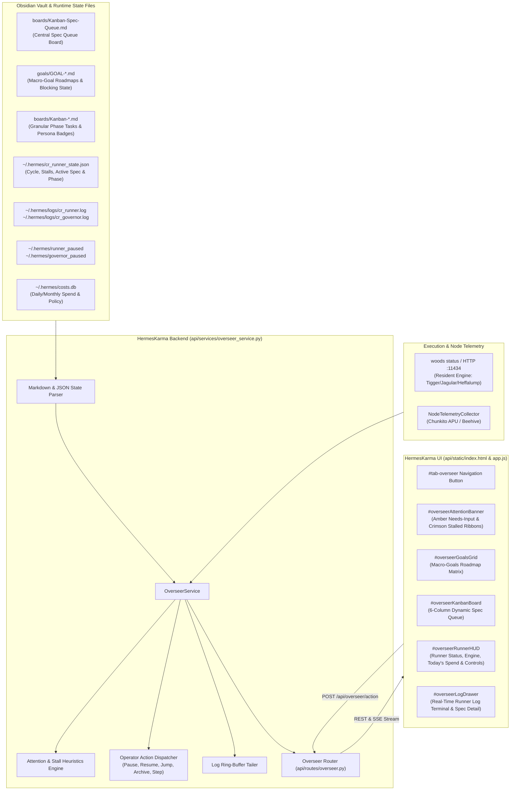

# Specification 10: Christopher Robin Overseer & Dynamic Spec Queue Control Plane

> **Tracking ID:** `SPEC-HK-010`  
> **Associated Tasks:** `TASK-HK-143` through `TASK-HK-148`  
> **Preceding Specs:** `SPEC-HK-001` (Multi-Node APU Telemetry), `SPEC-HK-006` (Fleet GPU History), `SPEC-HK-008` (Declarative Fleet Configuration), `SPEC-HK-009` (Homelab 3D Cluster Visualizer), `SPEC-HL-025` (Autonomous Macro-Goal Governor & Hardware Time-Sharing Architecture)  
> **Target Modules:** `api/services/overseer_service.py`, `api/routes/overseer.py`, `api/static/index.html`, `api/static/app.js`, `docs/architecture/10-christopher-robin-overseer-spec-queue-ui.md`, `docs/MAP.md`

---

## 1. Executive Summary & Problem Statement

### 1.1 The Operational Visibility Gap
`HermesKarma` provides deep telemetry into session history, token consumption, counterfactual cloud costs, Pantheon agent specializations, fleet APU hardware gauges, and 3D spatial infrastructure.

However, the **macro-execution engine** of the homelab operates outside the dashboard:
1. **The Christopher Robin Event Spine & Runner:** Driven autonomously by `scripts/cr_governor.py` (systemd timer) and `scripts/cr_runner.py` (background daemon `cr-runner.service`), executing multi-phase implementation waves across Chunkito's 128GB unified APU memory (`@tigger`, `@jagular`, `@heffalump`).
2. **Cross-Project Macro Goals (`goals/GOAL-*.md`):** Long-term roadmaps spanning Lunar Frontier (`playground`), Sunlit Hills home automation (`sunlit-hills`), Honeydew couples SaaS (`honeydew`), and distributed Homelab infrastructure (`homelab`).
3. **The Central Spec Queue (`boards/Kanban-Spec-Queue.md`):** Orchestrating cross-workspace backlog, queued specs, milestone line-jumping (`🚨 Expedited`), active runs, paused specs, and review gates (`🧪 Review & Ready to Test`).

Currently, when the autonomous runner enters states requiring human attention or hits execution roadblocks, the operator has no single pane of glass:
* **"Needs Input From Me" (Invisible Human Gates):** When a spec completes all phases and lands in `🧪 Review & Ready to Test`, or when a macro-goal status trips `HUMAN_PLAYTEST_REQUIRED` or the `HUMAN_REVIEW_GATE` ($\ge 3$ review specs), Chunkito yields hardware and halts autonomous dispatch. The operator only learns of this via sporadic Telegram pings or manual vault browsing.
* **"Stalled / Blocked" (Silent Failures):** When an autonomous run encounters `PHASE_FAILED` retries, a `NO_PHASES_FOUND` stall loop, a paused runner lockfile (`~/.hermes/runner_paused`), an APU daemon crash, or a cloud cost ceiling trip ($10/day), execution quietly freezes without a persistent visual alert.
* **Fragmented Management:** The operator must jump between CLI terminals (`cr_runner.py status`, `cr_governor.py status`, `woods status`), Obsidian Kanban markdown files, and raw runner logs (`~/.hermes/logs/cr_runner.log`) to diagnose state and unwedge the pipeline.

### 1.2 Objective & Core Value Proposition
This specification defines **Christopher Robin Overseer & Dynamic Spec Queue Control Plane** in `HermesKarma`:
1. **A Dedicated Executive Cockpit (`#tab-overseer`):** Elevating high-level swarm orchestration alongside Sessions, Pantheon, and Fleet Nodes.
2. **Visual Attention Engine:** Instant, unmissable amber/crimson status ribbons categorizing:
   * **Needs Your Input:** Specs waiting for qualitative playtesting/review (with preview links and instructions), unapproved human review gates, and strategic goal pivots.
   * **Stalled / Blocked:** Runner pauses, stall loop detections, test regressions, compute disconnects, and budget trips.
3. **Macro-Goals Matrix:** Dynamic overview of all active product roadmaps (`goals/GOAL-*.md`), milestone progress, active blocking states, and resident engine targets.
4. **Dynamic Spec Queue Kanban:** Real-time visual pipeline mirroring `boards/Kanban-Spec-Queue.md` with live phase progress, active subtask names, assigned personas, and git hashes.
5. **Interactive Operator Actions:** Low-friction operational controls directly from the browser:
   * **Pause / Resume Runner** (atomic lockfile control)
   * **Approve & Archive** (moves review specs to Done, unblocking the human review gate)
   * **Expedite / Jump Line** (promotes queued specs to `#p0` Expedited)
   * **Step Single Phase** (manually advances one atomic phase)
6. **Live Telemetry & Runner Log Stream:** Real-time log tail of `cr_runner.log` and `cr_governor.log` paired with SSE push updates.

---

## 2. Architecture & System Topology



---

## 3. Data Contracts & API Schema

### 3.1 REST Endpoints (`api/routes/overseer.py`)

#### A. `GET /api/overseer/overview`
Returns the complete unified state of all projects, spec queue, runner status, hardware occupancy, and evaluated attention items.

**Response Schema (`200 OK`):**
```json
{
  "timestamp": "2026-11-16T21:45:00-08:00",
  "runner": {
    "is_paused": false,
    "pause_reason": null,
    "lock_file_present": false,
    "status": "RUNNING",
    "active_spec_id": "SPEC-SUN-002",
    "active_spec_title": "Sunlit Hills: ThunderCats Camera Fleet & 4G Cellular Trail Cam Ingestion Engine",
    "workspace": "/home/jagosan/repos/sunlit-hills",
    "progress": {
      "completed_phases": 1,
      "total_phases": 4,
      "percentage": 25.0
    },
    "current_subtask": {
      "id": "TASK-SUN-002b",
      "title": "[Spec 2/Phase 2] Lightweight FTPS / HTTP Ingestion Sink for Cellular Units",
      "assignee": "tigger"
    },
    "stall_count": 0,
    "last_cycle_timestamp": "2026-11-16T21:44:30-08:00",
    "cloud_budget": {
      "today_usd": 0.00,
      "daily_ceiling_usd": 10.00,
      "month_usd": 0.00,
      "monthly_ceiling_usd": 50.00,
      "policy": "CLOUD_ALLOWED"
    }
  },
  "node": {
    "resident_engine": "tigger",
    "occupant_name": "🐯 TIGGER & PANTHEON SWARM",
    "model_id": "qwen3-coder-next:262k",
    "is_online": true,
    "is_idle": false,
    "slots_active": 2,
    "slots_total": 6
  },
  "attention": {
    "needs_input": [
      {
        "id": "input-play-038",
        "type": "HUMAN_PLAYTEST_REQUIRED",
        "severity": "high",
        "title": "Lunar Frontier: Subterranean Base Excavation Ready for Playtest",
        "description": "SPEC-PLAY-038 has completed all 5 phases on disk and passes NullEngine tests. Waiting for qualitative flight & mining verification.",
        "spec_id": "SPEC-PLAY-038",
        "workspace": "/home/jagosan/repos/playground",
        "playtest_url": "http://localhost:5173",
        "action_required": "Playtest core excavation & mining mechanics, then click Approve & Archive."
      }
    ],
    "stalled": [
      {
        "id": "stall-runner-paused",
        "type": "RUNNER_PAUSED",
        "severity": "critical",
        "title": "Autonomous Runner is Paused",
        "description": "Lockfile ~/.hermes/runner_paused is active. Swarm execution is suspended.",
        "remediation": "Click 'Resume Runner' or run 'cr_runner.py resume' to re-enable continuous dispatch."
      }
    ],
    "summary": {
      "needs_input_count": 1,
      "stalled_count": 1,
      "healthy": false
    }
  },
  "goals": [
    {
      "id": "GOAL-PLAY-001",
      "project": "playground",
      "title": "Lunar Frontier Space-Colony Sandbox",
      "status": "active",
      "blocking_state": "READY_FOR_EXECUTION",
      "workspace": "/home/jagosan/repos/playground",
      "board_link": "boards/Kanban-Playground.md",
      "human_gate_criteria": "Requires hands-on touch/controller playtest after milestone completion",
      "milestones_total": 6,
      "milestones_completed": 5,
      "active_milestone": "Milestone 6: Subterranean Base Expansion & Colony Life-Support"
    },
    {
      "id": "GOAL-SUN-001",
      "project": "sunlit-hills",
      "title": "Sunlit Hills Autonomous Home Automation & Edge Perception",
      "status": "active",
      "blocking_state": "READY_FOR_EXECUTION",
      "workspace": "/home/jagosan/repos/sunlit-hills",
      "board_link": "boards/Kanban-Sunlit-Hills.md",
      "human_gate_criteria": "Requires physical hardware verification on carport relays and cellular trails",
      "milestones_total": 4,
      "milestones_completed": 1,
      "active_milestone": "Milestone 2: Camera Fleet & 4G Trail Ingestion"
    }
  ],
  "queue": {
    "counts": {
      "backlog": 3,
      "queued": 6,
      "expedited": 0,
      "running": 1,
      "paused": 0,
      "review": 2,
      "done": 17
    },
    "columns": {
      "backlog": [...],
      "queued": [...],
      "expedited": [...],
      "running": [...],
      "paused": [...],
      "review": [...],
      "done": [...]
    }
  }
}
```

#### B. `GET /api/overseer/spec/{spec_id}`
Returns deep-dive metadata for a specific spec: full card annotations, parsed markdown specification content, companion architecture link, and granular subtask checklist from the associated project Kanban board (`boards/Kanban-<Project>.md`).

#### C. `GET /api/overseer/logs?lines=100`
Returns the recent unified execution trace from `~/.hermes/logs/cr_runner.log` and `~/.hermes/logs/cr_governor.log`.

#### D. `POST /api/overseer/action`
Executes operator commands with validation and atomic file mutations.

**Request Schema:**
```json
{
  "action": "pause_runner | resume_runner | expedite_spec | archive_spec | step_phase",
  "spec_id": "SPEC-PLAY-038", // required for expedite_spec, archive_spec
  "notes": "Approved flight feel after controller testing"
}
```

**Actions Handled:**
1. `pause_runner`: Creates `~/.hermes/runner_paused` lockfile atomically. Emits log.
2. `resume_runner`: Removes `~/.hermes/runner_paused` (and `~/.hermes/governor_paused`). Resets `stall_count` in `cr_runner_state.json`.
3. `expedite_spec`: Invokes `spec_queue_runner.py jump <spec_id>` or moves card in `Kanban-Spec-Queue.md` to `## 🚨 Expedited` with `#p0`. Staged and committed in vault git.
4. `archive_spec`: Moves card in `Kanban-Spec-Queue.md` (and corresponding project board) from `## 🧪 Review & Ready to Test` to `## ✅ Done & Archived`. Commits vault git, clears review gate if review count drops $< 3$.
5. `step_phase`: Invokes one non-blocking step (`python3 /home/jagosan/scripts/cr_runner.py step`) in background.

#### E. `GET /api/overseer/stream`
Server-Sent Events (SSE) streaming updates at 2-second intervals, emitting deltas when `cr_runner_state.json` mtime, lockfile state, or queue board mtime changes.

---

## 4. State Machine & Attention Heuristics

The Overseer Attention Engine evaluates state across four dimensions:
1. **Human Intervention Required (`needs_input`):**
   - **`HUMAN_PLAYTEST_REQUIRED`:** A spec is marked `[x]` in `🧪 Review & Ready to Test` with all phases completed, and its parent goal or spec metadata requires human playtesting or subjective evaluation.
   - **`HUMAN_REVIEW_GATE`:** The number of specs in `🧪 Review & Ready to Test` is $\ge 3$. The governor enforces an automatic compute yield to prevent runaway unverified coding.
   - **`GOAL_SPEC_AUTHORING`:** A macro-goal has finished its prior milestone and sits in `READY_FOR_SPEC_AUTHORING`, waiting for Christopher Robin or operator spec signoff.
   - **`SUBAGENT_ESCALATION`:** A subagent task failed with an unresolvable error after persona escalation, waiting for operator architectural guidance.
2. **Stalled or Blocked (`stalled`):**
   - **`RUNNER_PAUSED`:** `~/.hermes/runner_paused` or `~/.hermes/governor_paused` is present on disk.
   - **`STALL_LOOP_DETECTED`:** `cr_runner_state.json` reports `stall_count >= 2` (warning) or `stall_count >= 10` (critical loop). Runner is cycling without advancing phases.
   - **`PHASE_FAILED`:** A phase build or test execution failed during subagent execution.
   - **`NO_PHASES_FOUND`:** Active spec card exists in `🚧 Running` on `Kanban-Spec-Queue.md`, but no uncompleted child subtasks (`TASK-XX-NNNa`) can be parsed on the project board.
   - **`CLOUD_BUDGET_EXCEEDED`:** Daily cloud spend $\ge \$10.00$, blocking frontier API calls.
   - **`HARDWARE_OFFLINE`:** Chunkito APU / llama-server HTTP endpoint is unreachable or returning HTTP 503/500.
   - **`QUEUE_DRAINED`:** 0 running and 0 queued specs while hardware is idle.
3. **Cooperative Hardware Preemption:**
   - Detects when an `#engine/<beast>` tag on an expedited card differs from the resident engine, showing the upcoming switch required (`woods summon` vs `woods restore`).

---

## 5. UI/UX Design & Frontend Component Architecture

### 5.1 Placement & Navigation
- A dedicated button in the sidebar navigation:
  ```html
  <button onclick="switchTab('overseer')" id="tab-overseer" class="tab-btn ...">
    <i data-lucide="compass" class="w-4 h-4"></i>
    <span>Overseer & Queue</span>
  </button>
  ```
- Positioned directly above `Pantheon Swarm` or between `Pantheon Swarm` and `Fleet & APU Nodes`.

### 5.2 View Structure (`#view-overseer`)

#### 1. Attention & Alert Banners (Top Hero)
- If `needs_input` items exist: Render an **Amber / Golden Warning Banner** (`bg-amber-950/40 border-amber-500/40 text-amber-200`) with Lucide `alert-circle`, highlighting the exact action needed (e.g. *"Playtest Lunar Frontier Excavation (SPEC-PLAY-038) — 5/5 phases landed"*), with a 1-click **"Approve & Archive"** button and test URL link.
- If `stalled` items exist: Render a **Crimson Error Banner** (`bg-rose-950/40 border-rose-500/40 text-rose-200`) with Lucide `octagon-alert`, detailing the stall cause (e.g. *"Runner Paused via Lockfile"* or *"Stall Loop: No phases found for SPEC-SUN-002"*), with a 1-click **"Resume Runner"** or **"View Diagnostics"** button.

#### 2. Christopher Robin Autonomous Runner HUD
- **Runner State Pill:** 🟢 Active / ⏸️ Paused / ⚠️ Stalled
- **Resident Engine Badge:** 🐯 Tigger (6 slots) / 🐆 Jagular 177B (2 slots) / 🐘 Heffalump 284B (1 slot)
- **Active Execution Card:** Live Spec ID, Target Phase (e.g. `Phase 2/4: TASK-SUN-002b`), animated progress bar, and active persona avatar.
- **Spend & Safety Counter:** Cloud spend today (`$0.00 / $10.00`), Monthly (`$0.00 / $50.00`), Policy badge.
- **Controls Toolbar:**
  - `[⏸️ Pause Runner]` / `[▶️ Resume Runner]`
  - `[⚡ Step One Phase]`
  - `[📜 View Runner Logs]`
  - `[🔄 Refresh Queue]`

#### 3. Macro-Goals Matrix (`#overseerGoalsGrid`)
- A responsive card grid displaying each goal from `goals/GOAL-*.md`:
  - Project icon & Title (e.g. 🚀 Lunar Frontier, 🏡 Sunlit Hills, 💑 Honeydew, 🐝 Homelab Infra)
  - Status badge: `ACTIVE`, `PAUSED`, `BLOCKED`
  - Blocking State: `READY_FOR_EXECUTION` (green), `HUMAN_PLAYTEST_REQUIRED` (amber), `READY_FOR_SPEC_AUTHORING` (blue)
  - Phased Milestone Progress: Stacked progress bar (`Milestone 5/6: 83%`)
  - Target Engine tag (`#engine/jagular`, `#engine/tigger`)

#### 4. Dynamic Spec Queue Kanban Board (`#overseerKanbanBoard`)
- A full-width, 6-column horizontal Kanban view:
  1. `📥 Backlog`
  2. `⏳ Queued`
  3. `🚨 Expedited` (Jump-the-line)
  4. `🚧 Running` (Highlighted active card with pulsing border)
  5. `⏸️ Paused` (Preempted milestone checkpoints)
  6. `🧪 Review & Ready to Test` (Cards waiting for operator signoff)
- **Spec Card Elements:**
  - Spec ID tag (e.g. `SPEC-PLAY-039`)
  - Title & Repo link
  - Assigned Engine badge (`@tigger`, `@jagular`, `@heffalump`)
  - Priority badge (`#p0`, `#p1`)
  - Phase progress counter (`Phase 3/5`)
  - Quick Action Buttons:
    - On Queued cards: `[🚨 Expedite]` (jumps to Expedited)
    - On Review cards: `[✅ Approve & Archive]`
    - Card click opens sliding detail drawer.

#### 5. Spec & Log Sliding Drawer (`#overseerDrawer`)
- Slides in from the right when any card or "View Logs" is clicked:
  - Spec description, architecture link, and definition of done
  - Granular checklist of phase subtasks from `Kanban-<Project>.md`
  - Real-time scrollable log window with syntax-highlighted runner output

---

## 6. Phased Implementation Plan & Verification Gates

### Phase 1: Backend State Parser & REST API (`TASK-HK-143`)
* **Modules:** `api/services/overseer_service.py`, `api/routes/overseer.py`
* **Deliverables:**
  * Implement `OverseerService` with non-blocking file parsers for `Kanban-Spec-Queue.md`, `goals/GOAL-*.md`, and `~/.hermes/cr_runner_state.json`.
  * Support `GET /api/overseer/overview`, `GET /api/overseer/spec/{spec_id}`, and `GET /api/overseer/logs`.
  * Guarantee read-only filesystem operations with graceful fallbacks if files are momentarily locked or missing.

### Phase 2: Attention & Stall Heuristics Engine (`TASK-HK-144`)
* **Modules:** `api/services/overseer_service.py`
* **Deliverables:**
  * Implement rule-based evaluation for `needs_input` (`HUMAN_PLAYTEST_REQUIRED`, `HUMAN_REVIEW_GATE`, `READY_FOR_SPEC_AUTHORING`).
  * Implement rule-based evaluation for `stalled` (`RUNNER_PAUSED`, `STALL_LOOP_DETECTED`, `PHASE_FAILED`, `NO_PHASES_FOUND`, `BUDGET_CEILING_TRIPPED`, `HARDWARE_OFFLINE`).
  * Unit test assertion coverage for each heuristic state.

### Phase 3: Operator Action Dispatcher (`TASK-HK-145`)
* **Modules:** `api/routes/overseer.py`, `api/services/overseer_service.py`
* **Deliverables:**
  * Implement `POST /api/overseer/action` supporting `pause_runner`, `resume_runner`, `expedite_spec`, `archive_spec`, and `step_phase`.
  * Ensure atomic lockfile creation/deletion and safe vault git commits (`chore(spec-queue): ...`).
  * Protect against invalid card transitions or concurrent runner races.

### Phase 4: Frontend UI Components & Dynamic Kanban View (`TASK-HK-146`)
* **Modules:** `api/static/index.html`, `api/static/app.js`
* **Deliverables:**
  * Add `#tab-overseer` navigation button and `#view-overseer` DOM layout.
  * Implement Dynamic Attention Banners (amber & crimson alerts with action buttons).
  * Render Christopher Robin Runner HUD with live status, spend counters, and controls.
  * Render Macro-Goals Grid and 6-column Spec Queue Kanban Board.
  * Implement card interaction, quick-action hooks, and sliding inspector drawer.

### Phase 5: Comprehensive Unit & Integration Tests (`TASK-HK-147`)
* **Modules:** `tests/test_overseer.py`
* **Deliverables:**
  * End-to-end tests for all Overseer REST endpoints and SSE stream.
  * Mock tests for parser resilience against malformed markdown, missing fields, or empty queues.
  * Verify 100% test pass rate with isolated virtualenv execution (`env -u PYTHONPATH .venv/bin/python3 -m pytest`).

### Phase 6: Architecture Blueprint, Symbol Map Registration & Service Verification (`TASK-HK-148`)
* **Modules:** `docs/architecture/10-christopher-robin-overseer-spec-queue-ui.md`, `docs/MAP.md`
* **Deliverables:**
  * Author architectural blueprint and data flow sequence diagrams.
  * Update `docs/MAP.md` with new routes, services, and DOM elements.
  * Verify live service reload on `http://localhost:8020` via systemd user unit.

---

## 7. Quality Invariants & Security Guardrails
1. **Zero-LLM Polling Cost:** The Overseer service is purely deterministic Python ($0.00 cloud spend). It reads local markdown and JSON files without invoking language models.
2. **Safe Vault Git Commits:** Any state mutation triggered via UI actions (`expedite_spec`, `archive_spec`) uses atomic git commits on the Obsidian vault repository (`chore(spec-queue): ...`), preserving history and preventing merge conflicts.
3. **No Unilateral Daemon Mutations:** The UI provides observability into resident engines (`woods status`) but never kills or swaps GPU daemon containers without explicit operator command.
4. **Resilient Markdown Parsing:** Parsers must tolerate non-standard frontmatter, missing optional fields, or manual formatting edits in `Kanban-Spec-Queue.md` without throwing HTTP 500 exceptions.
5. **SSE Generator Test Hang Prevention:** The SSE endpoint (`/api/overseer/stream`) must support an optional `?max_events=N` parameter to prevent Starlette/httpx test clients from hanging indefinitely during test suites.
